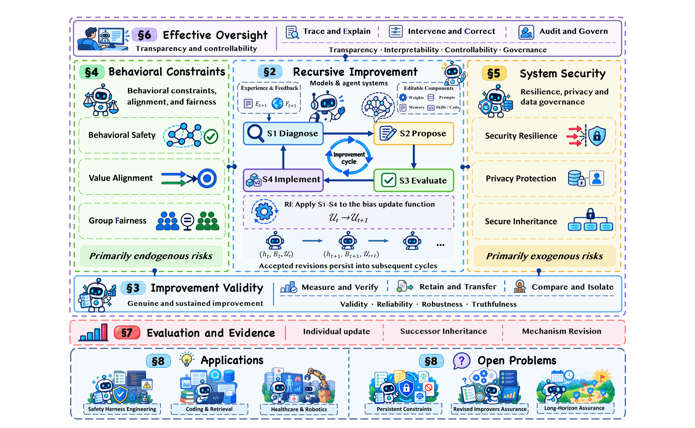
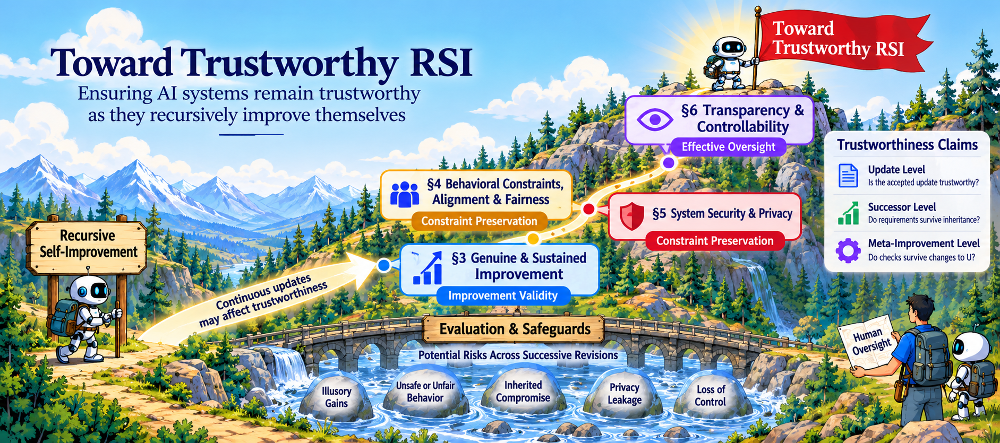

<div align="center">

# Trustworthy RSI

### Trustworthy Recursive Self-Improvement in the Era of Large Models

**Foundations, Risks, Evaluation, Applications, and Open Challenges**

[](docs/PAPER_INDEX.md)
[](bibliography/references.bib)
[](CONTRIBUTING.md)

[Survey Website](https://pujiayue.github.io/Trustworthy-RSI/) · [Reading List](#contents) · [Full Paper Index](docs/PAPER_INDEX.md) · [BibTeX](bibliography/references.bib) · [Contributing](CONTRIBUTING.md)

</div>

[](assets/overview.pdf)

> Trustworthy progress requires evidence that gains, safeguards, and human oversight remain effective across successive updates and recursive revisions.

Large-model systems increasingly turn experience into persistent changes to models, memories, tools, and workflows. Recursive self-improvement (RSI) extends this process to the mechanisms that generate, evaluate, and implement subsequent changes. This repository accompanies our survey and organizes literature through a **validity–risk–oversight** perspective.

We examine four connected themes: **genuine and sustained improvement**; **behavior, alignment, and fairness**; **security, privacy, and data governance**; and **transparency and control**. The taxonomy follows the survey rather than grouping papers only by the component being optimized.

The reading list contains **263 distinct references** across eight chapters. The [complete index](docs/PAPER_INDEX.md) and [BibTeX library](bibliography/references.bib) contain **413 references** supplied with the survey; 150 have no placement in the supplied taxonomy. Papers may appear in multiple subsections.

<details>
<summary>Visual abstract: toward trustworthy RSI</summary>



</details>

## Contents

- [Scope & Process Framework](#scope-and-process-framework)
- [1. Introduction](#introduction)
  - [1.1 Motivation](#motivation)
  - [1.2 Scope & Perspective](#scope)
  - [1.3 Related Surveys](#survey-comparison)
  - [1.4 Contributions](#contributions)
  - [1.5 Paper Organization](#organization)
- [2. Preliminaries](#foundations)
  - [2.1 RSI in Large Models](#rsi-foundations)
  - [2.2 Trustworthiness Requirements](#trustworthiness-concepts)
  - [2.3 Trustworthiness Under RSI](#rsi-trustworthiness)
- [3. Genuine & Sustained Improvement](#validity)
  - [3.1 Definitions & Claims](#validity-definitions)
  - [3.2 Risks & Failures](#validity-risks)
  - [3.3 Safeguards & Limits](#validity-safeguards)
  - [3.4 Evidence & Research Gaps](#validity-evidence)
- [4. Behavior, Alignment & Fairness](#behavior)
  - [4.1 Scope & Claims](#behavior-scope)
  - [4.2 Failures Across S1–S4 & RI](#behavior-failures)
  - [4.3 Behavioral & Normative Safeguards](#behavior-safeguards)
  - [4.4 Evidence & Research Gaps](#behavior-evidence)
- [5. Security, Privacy & Data Governance](#system-security)
  - [5.1 Risks Across S1–S4 & RI](#security-risks)
  - [5.2 Safeguards Across S1–S4 & RI](#security-safeguards)
  - [5.3 Evidence, Gaps & Priorities](#security-evidence)
- [6. Transparency & Control](#governance)
  - [6.1 Definitions & Claims](#governance-definitions)
  - [6.2 Risks & Failures](#governance-risks)
  - [6.3 Safeguards & Limits](#governance-safeguards)
  - [6.4 Evidence & Research Gaps](#governance-evidence)
- [7. Evaluation & Evidence](#evaluation)
  - [7.1 Evaluation Settings & Gaps](#eval-benchmarks)
  - [7.2 Longitudinal Tests: S1–S4/RI](#eval-longitudinal)
  - [7.3 Independent Evidence/Joint Tests](#eval-evidence)
- [8. Applications & Open Problems](#outlook)
  - [8.1 Findings & Evidence Bounds](#outlook-findings)
  - [8.2 Applications/Claim Transfer](#outlook-apps)
  - [8.3 Open Problems](#outlook-open)
- [Resources & Maintenance](#resources-and-maintenance)

<a id="scope-and-process-framework"></a>
## Scope & Process Framework

**Persistent self-improvement** retains changes for future use. **Recursive self-improvement** additionally revises the mechanism that produces subsequent updates. A higher task score or a self-referential design alone does not establish sustained or trustworthy improvement.

| Process | Question |
| :-- | :-- |
| **S1 · Improvement diagnosis** | What limitation should the next revision address? |
| **S2 · Proposal generation** | Which changes should be proposed? |
| **S3 · Proposal evaluation** | Which changes meet the acceptance criteria? |
| **S4 · Update implementation** | How are accepted changes retained in the successor system? |
| **RI · Recursive improvement** | What changes when S1–S4 revise the update mechanism itself? |

The four themes are assessed at the **update**, **successor**, and **meta-improvement** levels. Listed works include direct RSI studies, related self-evolving systems, and enabling foundations; placement in the taxonomy does not imply that a paper demonstrates open-ended RSI or validates a safeguard across all levels.

<a id="introduction"></a>
## 1. Introduction

Motivation, scope, and related surveys that frame trustworthy recursive self-improvement.

- **Small Is Beautiful** — **Small Is Beautiful: Economics as if People Mattered**. *1973* · [Reference](docs/PAPER_INDEX.md#schumacher1973small)

<a id="motivation"></a>
### 1.1 Motivation

- **GPT-6 Astra** — [GPT-6 Astra: A New Generation of Intelligence](https://openai.com/index/gpt-6-astra/). *2026* · [Reference](docs/PAPER_INDEX.md#openai2026gpt6astra)
- [Claude Opus 5.5](https://www.anthropic.com/claude-opus-5-5). *2026* · [Reference](docs/PAPER_INDEX.md#anthropic2026claudeopus55)
- **A Survey of Self-Evolving Agents** — [A Survey of Self-Evolving Agents: What, When, How, and Where to
Evolve on the Path to Artificial Super Intelligence](https://mlanthology.org/tmlr/2026/gao2026tmlr-survey/). *2026 · Transactions on Machine Learning Research* · [Reference](docs/PAPER_INDEX.md#gao2026selfevolving)
- **SEAL (Self-Adapting LLMs)** — [Self-Adapting Language Models](https://papers.neurips.cc/paper_files/paper/2025/hash/6b41e04c41726e2a60e456d0a2b961ab-Abstract-Conference.html). *2025 · Advances in Neural Information Processing Systems* · [Reference](docs/PAPER_INDEX.md#zweiger2025seal)
- **DGM (Darwin Gödel Machine)** — [Darwin Gödel Machine: Open-Ended Evolution of Self-Improving Agents](https://arxiv.org/abs/2505.22954). *2026 · International Conference on Learning Representations* · [Reference](docs/PAPER_INDEX.md#zhang2025dgm)
- [Hyperagents](https://arxiv.org/abs/2603.19461). *2026* · [Reference](docs/PAPER_INDEX.md#zhang2026hyperagents)
- **Dream-RSI** — [Dream-RSI: Recursive Self-Improvement through Evolving Worlds](https://arxiv.org/abs/2609.14858). *2026 · arXiv* · [Reference](docs/PAPER_INDEX.md#zheng2026dreamrsi)
- **ModularRSI** — [ModularRSI: Modular and Generalizable
Recursive Harness Self-Improvement](https://arxiv.org/abs/2609.14857). *2026* · [Reference](docs/PAPER_INDEX.md#wu2026modularrsi)
- **RRSI** — [RRSI: Regularized Recursive Self-Improvement
of Agent Harnesses](https://arxiv.org/abs/2609.24972). *2026* · [Reference](docs/PAPER_INDEX.md#xia2026rrsi)
- **Reflections on Trusting Trust, Revisited** — [Reflections on Trusting Trust, Revisited: Contaminating Self-Modifying AI Coding Agents with Poisoned Benchmarks](https://arxiv.org/abs/2609.17817). *2026* · [Reference](docs/PAPER_INDEX.md#roesner2026trustingtrust)
- **NIST AI RMF 1.0** — [Artificial Intelligence Risk Management Framework
(AI RMF 1.0)](https://doi.org/10.6028/NIST.AI.100-1). *2023* · [Reference](docs/PAPER_INDEX.md#nist2023airmf)
- **Recursive Self-Training Collapse in Code LLMs** — [When AI Reviews Its Own Code:
Recursive Self-Training Collapse in Code LLMs](https://arxiv.org/abs/2606.28438). *2026 · arXiv* · [Reference](docs/PAPER_INDEX.md#song2026recursivecollapse)
- **Library Drift** — [Library Drift: Diagnosing and Fixing a Silent Failure Mode
in Self-Evolving LLM Skill Libraries](https://arxiv.org/abs/2605.19576). *2026 · arXiv* · [Reference](docs/PAPER_INDEX.md#zhang2026librarydrift)
- **Fine-Tuning Aligned LLMs Compromises Safety** — [Fine-Tuning Aligned Language Models Compromises Safety,
Even When Users Do Not Intend To!](https://openreview.net/forum?id=hTEGyKf0dZ). *2024 · International Conference on Learning Representations* · [Reference](docs/PAPER_INDEX.md#qi2024finetuning)
- **Safety Risks in Experience-Driven Agents** — [On Safety Risks in Experience-Driven Self-Evolving Agents](https://aclanthology.org/2026.findings-acl.2091/). *2026* · [Reference](docs/PAPER_INDEX.md#zhao2026safetyrisks)
- **Social Biases Through Adaptive Exploration** — [Large Language Models Develop Novel Social Biases
Through Adaptive Exploration](https://arxiv.org/abs/2511.06148). *2026 · International Conference on Machine Learning* · [Reference](docs/PAPER_INDEX.md#wu2026socialbias)
- **MINJA** — [Memory Injection Attacks on LLM Agents
via Query-Only Interaction](https://proceedings.neurips.cc/paper_files/paper/2025/hash/42a97bbd9844d2bf68596730af80bcdf-Abstract-Conference.html). *2025 · Advances in Neural Information Processing Systems* · [Reference](docs/PAPER_INDEX.md#dong2025minja)
- **MEXTRA** — [Unveiling Privacy Risks in LLM Agent Memory](https://aclanthology.org/2025.acl-long.1227/). *2025* · [Reference](docs/PAPER_INDEX.md#wang2025agentmemoryprivacy)

<a id="scope"></a>
### 1.2 Scope & Perspective

The survey focuses on persistent updates and recursive revision of improvement mechanisms. Findings from neighboring LLM and agent research are relevant context, with their transfer limits kept explicit.

<a id="survey-comparison"></a>
### 1.3 Related Surveys

- [Trustworthy AI: From Principles to Practices](https://doi.org/10.1145/3555803). *2023 · ACM Computing Surveys* · [Reference](docs/PAPER_INDEX.md#li2023trustworthy)
- **Trustworthy LLMs: A Survey and Guideline** — [Trustworthy LLMs: A Survey and Guideline for Evaluating
Large Language Models' Alignment](https://arxiv.org/abs/2308.05374). *2023* · [Reference](docs/PAPER_INDEX.md#liu2023trustworthyllms)
- **A Survey on Trustworthy LLM Agents** — [A Survey on Trustworthy LLM Agents:
Threats and Countermeasures](https://doi.org/10.1145/3711896.3736561). *2025* · [Reference](docs/PAPER_INDEX.md#yu2025trustworthyagents)
- **Towards trustworthy agentic AI** — [Towards trustworthy agentic AI: a comprehensive survey
of safety, robustness, privacy, and system security](https://arxiv.org/abs/2605.23989). *2026 · Academia AI and Applications* · [Reference](docs/PAPER_INDEX.md#qi2026trustworthyagentic)
- **A Survey of Self-Evolving Agents** — [A Survey of Self-Evolving Agents: What, When, How, and Where to
Evolve on the Path to Artificial Super Intelligence](https://mlanthology.org/tmlr/2026/gao2026tmlr-survey/). *2026 · Transactions on Machine Learning Research* · [Reference](docs/PAPER_INDEX.md#gao2026selfevolving)
- **Diving into Reliable Self-Evolving Agents** — [Diving into Reliable Self-Evolving Agents: A Survey](https://openreview.net/forum?id=CGO1hDTHNe). *2026 · OpenReview.net* · [Reference](docs/PAPER_INDEX.md#wang2026diving)
- **AI4AI Survey** — [AI4AI Survey: From Long-Horizon Agents to Recursive
Self-Improvement—Definitions, Reliable Horizons,
and Open Problems](https://www.preprints.org/manuscript/202608.2108). *2026 · Preprints.org* · [Reference](docs/PAPER_INDEX.md#wu2026ai4ai)
- **Recursive Self-Improvement in AI** — [Recursive Self-Improvement in AI:
From Bounded Self-Refinement to Autonomous Research Loops](https://arxiv.org/abs/2607.07663). *2026* · [Reference](docs/PAPER_INDEX.md#chen2026recursive)
- **The Last AI Built by Humans** — [The Last AI Built by Humans: Toward Genuine Recursive
Self-Improvement](https://arxiv.org/abs/2609.11873). *2026* · [Reference](docs/PAPER_INDEX.md#duan2026last)

<a id="contributions"></a>
### 1.4 Contributions

- **Machine Learning**. *1997* · [Reference](docs/PAPER_INDEX.md#mitchell1997ml)

<a id="organization"></a>
### 1.5 Paper Organization

The reading path follows the eight survey chapters below, preserving the supplied section and subsection structure.

[↑ Contents](#contents)

<a id="foundations"></a>
## 2. Preliminaries

Definitions and trustworthiness requirements, from persistent adaptation to recursive changes in the mechanism that produces future updates.

<a id="rsi-foundations"></a>
### 2.1 RSI in Large Models

- **Machine Learning**. *1997* · [Reference](docs/PAPER_INDEX.md#mitchell1997ml)
- **Welcome to the era of experience**. *2025 · Google AI* · [Reference](docs/PAPER_INDEX.md#silver2025welcome)
- **Biases in Learning Generalizations** — **The Need for Biases in Learning Generalizations**. *1980* · [Reference](docs/PAPER_INDEX.md#mitchell1980bias)

<a id="trustworthiness-concepts"></a>
### 2.2 Trustworthiness Requirements

- [Trustworthy AI: From Principles to Practices](https://doi.org/10.1145/3555803). *2023 · ACM Computing Surveys* · [Reference](docs/PAPER_INDEX.md#li2023trustworthy)
- **NIST AI RMF 1.0** — [Artificial Intelligence Risk Management Framework
(AI RMF 1.0)](https://doi.org/10.6028/NIST.AI.100-1). *2023* · [Reference](docs/PAPER_INDEX.md#nist2023airmf)
- **TrustLLM** — [Position: TrustLLM: Trustworthiness in Large Language Models](https://proceedings.mlr.press/v235/huang24x.html). *2024* · [Reference](docs/PAPER_INDEX.md#huang2024trustllm)
- [Ethics Guidelines for Trustworthy AI](https://digital-strategy.ec.europa.eu/en/library/ethics-guidelines-trustworthy-ai). *2019* · [Reference](docs/PAPER_INDEX.md#hleg2019ethics)
- **Trustworthy LLMs: A Survey and Guideline** — [Trustworthy LLMs: A Survey and Guideline for Evaluating
Large Language Models' Alignment](https://arxiv.org/abs/2308.05374). *2023* · [Reference](docs/PAPER_INDEX.md#liu2023trustworthyllms)
- [Corrigibility](https://intelligence.org/files/Corrigibility.pdf). *2015* · [Reference](docs/PAPER_INDEX.md#soares2015corrigibility)

<a id="rsi-trustworthiness"></a>
### 2.3 Trustworthiness Under RSI

Assess trustworthiness at three levels: the accepted update, the systems that inherit it, and revisions to the mechanism governing future improvement.

[↑ Contents](#contents)

<a id="validity"></a>
## 3. Genuine & Sustained Improvement

Whether measured gains are genuine, persist in successor systems, and survive changes to the improvement mechanism. Topics include collapse, forgetting, reward hacking, evaluator drift, and independent validation.

<a id="validity-definitions"></a>
### 3.1 Definitions & Claims

- [Trustworthy AI: From Principles to Practices](https://doi.org/10.1145/3555803). *2023 · ACM Computing Surveys* · [Reference](docs/PAPER_INDEX.md#li2023trustworthy)
- **NIST AI RMF 1.0** — [Artificial Intelligence Risk Management Framework
(AI RMF 1.0)](https://doi.org/10.6028/NIST.AI.100-1). *2023* · [Reference](docs/PAPER_INDEX.md#nist2023airmf)
- **Recursive Self-Improvement in AI** — [Recursive Self-Improvement in AI:
From Bounded Self-Refinement to Autonomous Research Loops](https://arxiv.org/abs/2607.07663). *2026* · [Reference](docs/PAPER_INDEX.md#chen2026recursive)
- **Diving into Reliable Self-Evolving Agents** — [Diving into Reliable Self-Evolving Agents: A Survey](https://openreview.net/forum?id=CGO1hDTHNe). *2026 · OpenReview.net* · [Reference](docs/PAPER_INDEX.md#wang2026diving)
- **The Last AI Built by Humans** — [The Last AI Built by Humans: Toward Genuine Recursive
Self-Improvement](https://arxiv.org/abs/2609.11873). *2026* · [Reference](docs/PAPER_INDEX.md#duan2026last)

<a id="validity-risks"></a>
### 3.2 Risks & Failures

- **Model Collapse on Recursively Generated Data** — [AI Models Collapse When Trained on Recursively Generated Data](https://www.nature.com/articles/s41586-024-07566-y). *2024 · Nature* · [Reference](docs/PAPER_INDEX.md#shumailov2024collapse)
- [Self-Consuming Generative Models Go MAD](https://proceedings.iclr.cc/paper_files/paper/2024/hash/ebc042e767de551803ccfcc45e2454f5-Abstract-Conference.html). *2024 · International Conference on Learning Representations* · [Reference](docs/PAPER_INDEX.md#alemohammad2024mad)
- [Rate of Model Collapse in Recursive Training](https://arxiv.org/abs/2412.17646). *2024* · [Reference](docs/PAPER_INDEX.md#suresh2024collapserate)
- **Recursive Self-Training Collapse in Code LLMs** — [When AI Reviews Its Own Code:
Recursive Self-Training Collapse in Code LLMs](https://arxiv.org/abs/2606.28438). *2026 · arXiv* · [Reference](docs/PAPER_INDEX.md#song2026recursivecollapse)
- **Self-Improvement Reversal in Post-training** — [Progress or Regress? Self-Improvement Reversal in Post-training](https://arxiv.org/abs/2407.05013). *2024* · [Reference](docs/PAPER_INDEX.md#wu2024reversal)
- **Credit Without Ground Truth** — [Credit Without Ground Truth: Auditing Step-Level Credit Assignment in LLM Agents Against Executed Replay](https://arxiv.org/abs/2608.19760). *2026* · [Reference](docs/PAPER_INDEX.md#zhang2026credit)
- **LLMs Cannot Self-Correct Reasoning Yet** — [Large Language Models Cannot Self-Correct Reasoning Yet](https://proceedings.iclr.cc/paper_files/paper/2024/hash/8b4add8b0aa8749d80a34ca5d941c355-Abstract-Conference.html). *2024 · International Conference on Learning Representations* · [Reference](docs/PAPER_INDEX.md#huang2024selfcorrect)
- **Contextual Drag** — [Contextual Drag: How Errors in the Context Affect LLM Reasoning](https://arxiv.org/abs/2602.04288). *2026* · [Reference](docs/PAPER_INDEX.md#cheng2026contextualdrag)
- [Defining and Characterizing Reward Hacking](https://arxiv.org/abs/2209.13085). *2022* · [Reference](docs/PAPER_INDEX.md#skalse2022rewardhacking)
- **Hack-Verifiable TextArena** — [Hack-Verifiable Environments: Towards Evaluating Reward Hacking at Scale](https://arxiv.org/abs/2605.20744). *2026* · [Reference](docs/PAPER_INDEX.md#roth2026hackverifiable)
- **Execution-Grounded Automated AI Research** — [Towards Execution-Grounded Automated AI Research](https://arxiv.org/abs/2601.14525). *2026* · [Reference](docs/PAPER_INDEX.md#si2026executiongrounded)
- **Spurious Tool Use** — [Spurious Tool Use:
When RL Agents Learn the Wrong Reason to Act](https://arxiv.org/abs/2609.16268). *2026* · [Reference](docs/PAPER_INDEX.md#yang2026spurious)
- **Evaluating Harness Evolution for Agents** — [Rethinking the Evaluation of Harness Evolution for Agents](https://arxiv.org/abs/2607.12227). *2026* · [Reference](docs/PAPER_INDEX.md#wang2026harnessevaluation)
- [Self-Rewarding Language Models](https://arxiv.org/abs/2401.10020). *2025* · [Reference](docs/PAPER_INDEX.md#yuan2025selfrewarding)
- **SelfAware** — [Do Large Language Models Know What They Don't Know?](https://arxiv.org/abs/2305.18153). *2023* · [Reference](docs/PAPER_INDEX.md#yin2023selfknowledge)
- [Language Models (Mostly) Know What They Know](https://arxiv.org/abs/2207.05221). *2022* · [Reference](docs/PAPER_INDEX.md#kadavath2022know)
- **CrossFit (False Frontiers)** — [False Frontiers: Diagnosing and Mitigating Co-Cheating in Self-Evolving Search Agents](https://arxiv.org/abs/2609.39102). *2026* · [Reference](docs/PAPER_INDEX.md#chen2026falsefrontiers)
- **SEAL (Sealed Exogenous Acceptance Loop)** — [Self-Authored Verification Is Unreliable in
Heuristic Self-Improving Agents](https://arxiv.org/abs/2607.24300). *2026* · [Reference](docs/PAPER_INDEX.md#guo2026selfauthored)
- **HackDetect** — [Do Agent Benchmarks Measure Capability? Protocol Validity in the Age of Agentic AI](https://arxiv.org/abs/2607.22368). *2026* · [Reference](docs/PAPER_INDEX.md#shao2026protocolvalidity)
- **PIVOT-KG** — [When Better Gets Worse: Improvement Fidelity for Self-Improving Agents in Adaptive Worlds](https://arxiv.org/abs/2609.32677). *2026* · [Reference](docs/PAPER_INDEX.md#wang2026whenbettergetsworse)
- **Double Ratchet** — [Who Grades the Grader? Co-Evolving Evaluation Metrics and Skills for Self-Improving LLM Agents](https://arxiv.org/abs/2607.12790). *2026* · [Reference](docs/PAPER_INDEX.md#zhang2026grader)
- **Capability-Preserving Evolution (CPE)** — [Do Self-Evolving Agents Forget? Capability Degradation
and Preservation in Lifelong LLM Agent Adaptation](https://arxiv.org/abs/2605.09315). *2026* · [Reference](docs/PAPER_INDEX.md#yu2026forget)
- **SEVA** — [SEVA: Self-Evolving Verification Agent with Process Reward for Fact Attribution](https://arxiv.org/abs/2606.29713). *2026* · [Reference](docs/PAPER_INDEX.md#yuan2026seva)
- **Library Drift** — [Library Drift: Diagnosing and Fixing a Silent Failure Mode
in Self-Evolving LLM Skill Libraries](https://arxiv.org/abs/2605.19576). *2026 · arXiv* · [Reference](docs/PAPER_INDEX.md#zhang2026librarydrift)
- **Verifier-as-Gatekeeper (VaG)** — [When Self-Evolution Backfires: Pre-Commit Gating against
Skill Contamination in LLM Agents](https://arxiv.org/abs/2608.05810). *2026* · [Reference](docs/PAPER_INDEX.md#shang2026precommit)
- **CO-evolution Drift Audit (CODA)** — [Evolving Together, Failing Apart: The Skill-Policy Co-evolution Trap in Self-Improving Agents](https://arxiv.org/abs/2610.20845). *2026* · [Reference](docs/PAPER_INDEX.md#feng2026evolvingtogether)
- **Harness Updating Is Not Harness Benefit** — [Harness Updating Is Not Harness Benefit: Disentangling Evolution Capabilities in Self-Evolving LLM Agents](https://arxiv.org/abs/2605.30621). *2026* · [Reference](docs/PAPER_INDEX.md#lin2026harnessbenefit)
- **Meta-Rewarding Language Models** — [Meta-Rewarding Language Models: Self-Improving Alignment with LLM-as-a-Meta-Judge](https://arxiv.org/abs/2407.19594). *2024* · [Reference](docs/PAPER_INDEX.md#wu2024metarewarding)
- **EvoLM** — [EvoLM: Self-Evolving Language Models through Co-Evolved Discriminative Rubrics](https://arxiv.org/abs/2605.03871). *2026* · [Reference](docs/PAPER_INDEX.md#li2026evolm)
- **SERPO** — [SERPO: Self-Evolving Rubric Policy Optimization for Open-Ended Test-Time Reinforcement Learning](https://arxiv.org/abs/2607.26873). *2026* · [Reference](docs/PAPER_INDEX.md#wang2026serpo)
- **A-Evolve-Training** — [A-Evolve-Training: Autonomous Post-Training of a 30B Model](https://arxiv.org/abs/2606.20657). *2026* · [Reference](docs/PAPER_INDEX.md#shi2026aevolvetraining)

<a id="validity-safeguards"></a>
### 3.3 Safeguards & Limits

- **Is Model Collapse Inevitable?** — [Is Model Collapse Inevitable? Breaking the Curse of Recursion
by Accumulating Real and Synthetic Data](https://arxiv.org/abs/2404.01413). *2024* · [Reference](docs/PAPER_INDEX.md#gerstgrasser2024accumulating)
- **RISE** — [RISE: Reliable Improvement in Self-Evolving Vision-Language Models](https://arxiv.org/abs/2605.20914). *2026* · [Reference](docs/PAPER_INDEX.md#xu2026rise)
- **Prism** — [Preventing Curriculum Collapse in Self-Evolving Reasoning Systems](https://arxiv.org/abs/2603.13309). *2026* · [Reference](docs/PAPER_INDEX.md#mishra2026prism)
- **SELAUR** — [SELAUR: Self Evolving LLM Agent via Uncertainty-aware Rewards](https://arxiv.org/abs/2602.21158). *2026* · [Reference](docs/PAPER_INDEX.md#zhang2026selaur)
- **ACE (Agentic Context Engineering)** — [Agentic Context Engineering: Evolving Contexts for Self-Improving Language Models](https://arxiv.org/abs/2510.04618). *2025* · [Reference](docs/PAPER_INDEX.md#zhang2025ace)
- **Evolving-RL** — [Evolving-RL: End-to-End Optimization of Experience-Driven Self-Evolving Capability within Agents](https://arxiv.org/abs/2605.10663). *2026* · [Reference](docs/PAPER_INDEX.md#fan2026evolvingrl)
- **ReSTEM** — [Beyond Human Data: Scaling Self-Training for Problem-Solving with Language Models](https://arxiv.org/abs/2312.06585). *2023* · [Reference](docs/PAPER_INDEX.md#singh2023restem)
- **Self-Verification Prevents Model Collapse** — [Self-Verification Provably Prevents Model Collapse
in Recursive Synthetic Training](https://proceedings.neurips.cc/paper_files/paper/2025/hash/3380e8116452e0efbf36f35d95e88c94-Abstract-Conference.html). *2025 · Advances in Neural Information Processing Systems* · [Reference](docs/PAPER_INDEX.md#fu2025selfverification)
- **Model Collapse: Synthetic Data Verification** — [Escaping Model Collapse via Synthetic Data Verification: Near-term Improvements and Long-term Convergence](https://arxiv.org/abs/2510.16657). *2025* · [Reference](docs/PAPER_INDEX.md#yi2025escapingcollapse)
- **MAP-Elites** — [Illuminating search spaces by mapping elites](https://arxiv.org/abs/1504.04909). *2015* · [Reference](docs/PAPER_INDEX.md#mouret2015mapelites)
- **Quality Diversity (QD)** — [Quality Diversity: A New Frontier for Evolutionary Computation](https://www.frontiersin.org/journals/robotics-and-ai/articles/10.3389/frobt.2016.00040/full). *2016 · Frontiers in Robotics and AI* · [Reference](docs/PAPER_INDEX.md#pugh2016qualitydiversity)
- **HarnessBank** — [HarnessBank: Semantic Gene-Bank Search with Gated Verification for Agent-Harness Self-Evolution](https://arxiv.org/abs/2607.13683). *2026* · [Reference](docs/PAPER_INDEX.md#luo2026harnessbank)
- **MLEvolve** — [MLEvolve: A Self-Evolving Framework for Automated Machine Learning Algorithm Discovery](https://arxiv.org/abs/2606.06473). *2026* · [Reference](docs/PAPER_INDEX.md#du2026mlevolve)
- **SEAL (Self-Adapting LLMs)** — [Self-Adapting Language Models](https://papers.neurips.cc/paper_files/paper/2025/hash/6b41e04c41726e2a60e456d0a2b961ab-Abstract-Conference.html). *2025 · Advances in Neural Information Processing Systems* · [Reference](docs/PAPER_INDEX.md#zweiger2025seal)
- **LSE (Learning to Self-Evolve)** — [Learning to Self-Evolve](https://arxiv.org/abs/2603.18620). *2026* · [Reference](docs/PAPER_INDEX.md#chen2026lse)
- **AIDE** — [AIDE: AI-Driven Exploration in the Space of Code](https://arxiv.org/abs/2502.13138). *2025* · [Reference](docs/PAPER_INDEX.md#jiang2025aide)
- **AlphaEvolve** — [AlphaEvolve: A coding agent for scientific and algorithmic discovery](https://arxiv.org/abs/2506.13131). *2025* · [Reference](docs/PAPER_INDEX.md#novikov2025alphaevolve)
- **RST (Recursive Synthetic Terminal Tasks)** — [Recursive Synthesis for Long-Horizon Terminal Tasks](https://arxiv.org/abs/2608.05466). *2026* · [Reference](docs/PAPER_INDEX.md#li2026rst)
- **SkillOpt** — [SkillOpt: Executive Strategy for Self-Evolving Agent Skills](https://arxiv.org/abs/2605.23904). *2026* · [Reference](docs/PAPER_INDEX.md#yang2026skillopt)
- **SIFT** — [Self Improvement via Fast Tree-search](https://arxiv.org/abs/2609.19526). *2026* · [Reference](docs/PAPER_INDEX.md#fu2026sift)
- **RRSI** — [RRSI: Regularized Recursive Self-Improvement
of Agent Harnesses](https://arxiv.org/abs/2609.24972). *2026* · [Reference](docs/PAPER_INDEX.md#xia2026rrsi)
- **HarnessCompass** — [HarnessCompass: Guiding Automatic Harness Evolution toward Generalizable and Effective Agent Harnesses](https://arxiv.org/abs/2608.01918). *2026* · [Reference](docs/PAPER_INDEX.md#zhang2026harnesscompass)
- **RSEA** — [Recursive Self-Evolving Agents via Held-Out Selection](https://arxiv.org/abs/2606.28374). *2026* · [Reference](docs/PAPER_INDEX.md#nguyen2026rsea)
- **HarnessEvolve** — [HarnessEvolve: Learning from Reference Trajectories for Reliable Agent Self-Evolution](https://arxiv.org/abs/2609.00829). *2026* · [Reference](docs/PAPER_INDEX.md#jiang2026harnessevolve)
- **The Reusable Holdout** — [The Reusable Holdout: Preserving Validity in Adaptive Data Analysis](https://doi.org/10.1126/science.aaa9375). *2015 · Science* · [Reference](docs/PAPER_INDEX.md#dwork2015reusable)
- **Model-Written Evaluations** — [Discovering Language Model Behaviors with Model-Written Evaluations](https://arxiv.org/abs/2212.09251). *2022* · [Reference](docs/PAPER_INDEX.md#perez2022modelwritten)
- **BenchGuard** — [Who Guards the Benchmarks? Automated Auditing of LLM Agent Benchmarks](https://arxiv.org/abs/2604.24955). *2026* · [Reference](docs/PAPER_INDEX.md#tu2026benchguard)
- **Auto Benchmark Audit (ABA)** — [Automated Benchmark Auditing for AI Agents and Large Language Models](https://arxiv.org/abs/2605.26079). *2026* · [Reference](docs/PAPER_INDEX.md#wang2026benchmarkaudit)
- **Verifying the Verifiers** — [Verifying the Verifiers: Unveiling Pitfalls and Potentials in Fact Verifiers](https://arxiv.org/abs/2506.13342). *2025* · [Reference](docs/PAPER_INDEX.md#seo2025factverifiers)
- **AutoResearch** — [AutoResearch: Insight In, Hallucination Out](https://arxiv.org/abs/2608.17906). *2026* · [Reference](docs/PAPER_INDEX.md#liu2026autoresearch)
- **MedRSI** — [MedRSI: Recursive Self-Improvement for Medical Agents via Clinically Aligned Self-Evolution](https://arxiv.org/abs/2609.24838). *2026* · [Reference](docs/PAPER_INDEX.md#wu2026medrsirecursiveselfimprovementmedical)
- **Chain-of-Verification (CoVe)** — [Chain-of-Verification Reduces Hallucination in Large Language Models](https://arxiv.org/abs/2309.11495). *2023* · [Reference](docs/PAPER_INDEX.md#dhuliawala2023cove)
- **CRITIC** — [CRITIC: Large Language Models Can Self-Correct with Tool-Interactive Critiquing](https://arxiv.org/abs/2305.11738). *2023* · [Reference](docs/PAPER_INDEX.md#gou2023critic)
- **rStar-Math** — [rStar-Math: Small LLMs Can Master Math Reasoning with Self-Evolved Deep Thinking](https://arxiv.org/abs/2501.04519). *2025* · [Reference](docs/PAPER_INDEX.md#guan2025rstarmath)
- **ReVeal** — [ReVeal: Self-Evolving Code Agents via Reliable Self-Verification](https://arxiv.org/abs/2506.11442). *2025* · [Reference](docs/PAPER_INDEX.md#jin2025reveal)
- **PRM800K (process supervision)** — [Let's Verify Step by Step](https://arxiv.org/abs/2305.20050). *2023* · [Reference](docs/PAPER_INDEX.md#lightman2023processsupervision)
- **STV** — [Self-Trained Verification for Training- and Test-Time Self-Improvement](https://arxiv.org/abs/2605.30290). *2026* · [Reference](docs/PAPER_INDEX.md#wu2026stv)
- **DeepVerifier** — [Inference-Time Scaling of Verification: Self-Evolving Deep Research Agents via Test-Time Rubric-Guided Verification](https://arxiv.org/abs/2601.15808). *2026* · [Reference](docs/PAPER_INDEX.md#wan2026deepverifier)
- **Red Queen Gödel Machine** — [The Red Queen Gödel Machine: Co-Evolving Agents and Their Evaluators](https://arxiv.org/abs/2606.26294). *2026* · [Reference](docs/PAPER_INDEX.md#iacob2026redqueen)
- **SpecRSI** — [Drafting Agents, Not Just Tokens: Speculative Recursive Self-Improvement for Agentic Systems](https://arxiv.org/abs/2610.16491). *2026* · [Reference](docs/PAPER_INDEX.md#xu2026drafting)
- **PACE** — [PACE: Anytime-Valid Acceptance Tests for Self-Evolving Agents](https://arxiv.org/abs/2606.08106). *2026* · [Reference](docs/PAPER_INDEX.md#shawn2026pace)
- **SGM** — [SGM: A Statistical Godel Machine for Risk-Controlled Recursive Self-Modification](https://arxiv.org/abs/2510.10232). *2026* · [Reference](docs/PAPER_INDEX.md#wu2026sgm)
- **POWERPLAY** — [POWERPLAY: Training an Increasingly General Problem Solver by Continually Searching for the Simplest Still Unsolvable Problem](https://arxiv.org/abs/1112.5309). *2011* · [Reference](docs/PAPER_INDEX.md#schmidhuber2011powerplay)
- **GRASP** — [GRASP: Gated Regression-Aware Skill Proposer for Self-Improving LLM Agents](https://arxiv.org/abs/2605.29668). *2026* · [Reference](docs/PAPER_INDEX.md#moll2026grasp)
- **Self-Harness** — [Self-Harness: Harnesses That Improve Themselves](https://arxiv.org/abs/2606.09498). *2026* · [Reference](docs/PAPER_INDEX.md#zhang2026selfharness)
- **Continual Harness** — [Continual Harness: Online Adaptation for Self-Improving Foundation Agents](https://arxiv.org/abs/2605.09998). *2026* · [Reference](docs/PAPER_INDEX.md#karten2026continualharness)
- **EvoHunt** — [Transferable Self-Evolving Playbooks for Agentic Security Auditing](https://arxiv.org/abs/2606.16420). *2026* · [Reference](docs/PAPER_INDEX.md#wang2026evohunt)
- **SkillZip** — [SkillZip: Evaluation-Free Skill Compression for Self-Evolving Agents by Discovering Reusable Structure](https://arxiv.org/abs/2608.11079). *2026* · [Reference](docs/PAPER_INDEX.md#bai2026skillzip)
- **PACEvolve** — [PACEvolve: Enabling Progress-Aware Consistent Evolution](https://arxiv.org/abs/2601.10657). *2026* · [Reference](docs/PAPER_INDEX.md#yan2026pacevolve)
- **CoEvoSkills** — [CoEvoSkills: Self-Evolving Agent Skills via Co-Evolutionary Verification](https://arxiv.org/abs/2604.01687). *2026* · [Reference](docs/PAPER_INDEX.md#zhang2026coevoskills)
- **DynamicRubric** — [Co-Evolving LLM Evaluators and Policies via DynamicRubric](https://arxiv.org/abs/2607.20083). *2026* · [Reference](docs/PAPER_INDEX.md#wang2026dynamicrubric)
- **SkillCoach** — [SkillCoach: Self-Evolving Rubrics for Evaluating and Enhancing Agentic Skill-Use](https://arxiv.org/abs/2607.01874). *2026* · [Reference](docs/PAPER_INDEX.md#zhu2026skillcoach)
- **CoNL** — [Conversation for Non-verifiable Learning: Self-Evolving LLMs through Meta-Evaluation](https://arxiv.org/abs/2601.21464). *2026* · [Reference](docs/PAPER_INDEX.md#sui2026conl)
- **DecoEvo** — [DecoEvo: Score-Decoupled Co-Evolution of Solver and Rubric-Generator Skills in Text Space](https://arxiv.org/abs/2607.25675). *2026* · [Reference](docs/PAPER_INDEX.md#chen2026decoevo)
- **EvoRubrics** — [EvoRubrics: Dynamic Rubrics as Rewards via Adversarial Co-Evolution for LLM Reinforcement Learning](https://arxiv.org/abs/2606.23038). *2026* · [Reference](docs/PAPER_INDEX.md#ding2026evorubrics)
- **Recursive Reward Improvement** — [Recursive Reward Improvement via Adversarial Meta-Prompt Evolution](https://arxiv.org/abs/2610.21040). *2026* · [Reference](docs/PAPER_INDEX.md#dai2026recursivereward)
- **Evo2** — [Evo$^2$: Evolving the Evolver through Weight-Harness Co-Evolution](https://arxiv.org/abs/2610.13025). *2026* · [Reference](docs/PAPER_INDEX.md#xu2026evo2)
- **Dream-RSI** — [Dream-RSI: Recursive Self-Improvement through Evolving Worlds](https://arxiv.org/abs/2609.14858). *2026 · arXiv* · [Reference](docs/PAPER_INDEX.md#zheng2026dreamrsi)
- **EvoRubric** — [EvoRubric: Self-Evolving Rubric-Driven RL for Open-Ended Generation](https://arxiv.org/abs/2605.29847). *2026* · [Reference](docs/PAPER_INDEX.md#guan2026evorubric)
- **TEMPO** — [TEMPO: Scaling Test-time Training for Large Reasoning Models](https://arxiv.org/abs/2604.19295). *2026* · [Reference](docs/PAPER_INDEX.md#zhang2026tempo)
- **SEA** — [Self-Evolving Agents with Anytime-Valid Certificates](https://arxiv.org/abs/2607.00871). *2026* · [Reference](docs/PAPER_INDEX.md#sengupta2026certificates)

<a id="validity-evidence"></a>
### 3.4 Evidence & Research Gaps

- **SICA** — [A Self-Improving Coding Agent](https://arxiv.org/abs/2504.15228). *2025* · [Reference](docs/PAPER_INDEX.md#robeyns2025sica)
- **SIA** — [SIA: Self Improving AI with Harness & Weight Updates](https://arxiv.org/abs/2605.27276). *2026* · [Reference](docs/PAPER_INDEX.md#hebbar2026sia)
- **ASI-Evolve** — [ASI-Evolve: AI Accelerates AI](https://arxiv.org/abs/2603.29640). *2026* · [Reference](docs/PAPER_INDEX.md#xu2026asievolve)
- **SCoRe** — [Training Language Models to Self-Correct via Reinforcement Learning](https://proceedings.iclr.cc/paper_files/paper/2025/hash/871ac99fdc5282d0301934d23945ebaa-Abstract-Conference.html). *2025 · International Conference on Learning Representations* · [Reference](docs/PAPER_INDEX.md#kumar2025score)
- **Self-Improvement Can Self-Regress** — [Self-Improvement Can Self-Regress: The Rise-and-Collapse
Failure Mode of LLM Self-Training](https://arxiv.org/abs/2606.21090). *2026* · [Reference](docs/PAPER_INDEX.md#lin2026selfregress)
- **Gödel Agent** — [Gödel Agent: A Self-Referential Agent Framework for Recursively Self-Improvement](https://aclanthology.org/2025.acl-long.1354/). *2025* · [Reference](docs/PAPER_INDEX.md#yin2025godel)
- **Reinforcement Fine-Tuning Reduces Forgetting** — [Reinforcement Fine-Tuning Naturally Mitigates Forgetting in Continual Post-Training](https://proceedings.mlr.press/v306/lai26h.html). *2026* · [Reference](docs/PAPER_INDEX.md#lai2026reinforcement)
- **AgentRxiv** — [AgentRxiv: Towards Collaborative Autonomous Research](https://arxiv.org/abs/2503.18102). *2025* · [Reference](docs/PAPER_INDEX.md#schmidgall2025agentrxiv)
- **Frontis-MA1** — [Frontis-MA1: Training an AI4AI Model towards Recursive Self-Improvement in Machine Learning Engineering](https://arxiv.org/abs/2607.28568). *2026* · [Reference](docs/PAPER_INDEX.md#yang2026frontis)
- **ReGenesis** — [ReGenesis: LLMs can Grow into Reasoning Generalists via Self-Improvement](https://proceedings.iclr.cc/paper_files/paper/2025/hash/9c77f2ce42151b2c2e26d2cf47f99564-Abstract-Conference.html). *2025 · International Conference on Learning Representations* · [Reference](docs/PAPER_INDEX.md#peng2025regenesis)
- **Agent Plasticity** — [Agent Plasticity: Measuring Self-Improvement Through Experience](https://arxiv.org/abs/2610.08902). *2026* · [Reference](docs/PAPER_INDEX.md#singh2026plasticity)
- **STOP** — [Self-Taught Optimizer (STOP):
Recursively Self-Improving Code Generation](https://openreview.net/forum?id=46Zgqo4QIU). *2024 · Conference on Language Modeling* · [Reference](docs/PAPER_INDEX.md#zelikman2024stop)
- [Hyperagents](https://arxiv.org/abs/2603.19461). *2026* · [Reference](docs/PAPER_INDEX.md#zhang2026hyperagents)
- **FARS** — [FARS: A Fully Automated Research System Deployed at Scale](https://arxiv.org/abs/2606.31651). *2026* · [Reference](docs/PAPER_INDEX.md#tang2026fars)
- **AI Sandbagging** — [AI Sandbagging: Language Models can Strategically Underperform on Evaluations](https://proceedings.iclr.cc/paper_files/paper/2025/hash/b5e5753b0a0e440a6d8dc7e143617cec-Abstract-Conference.html). *2025 · International Conference on Learning Representations* · [Reference](docs/PAPER_INDEX.md#vanderweij2025sandbagging)
- **Evaluating Harness Evolution for Agents** — [Rethinking the Evaluation of Harness Evolution for Agents](https://arxiv.org/abs/2607.12227). *2026* · [Reference](docs/PAPER_INDEX.md#wang2026harnessevaluation)
- **Does RL Enable Reasoning Beyond the Base?** — [Does Reinforcement Learning Really Incentivize Reasoning Capacity in LLMs Beyond the Base Model?](https://papers.nips.cc/paper_files/paper/2025/hash/537d5aa768c2d534016a4d06f87bc8fb-Abstract-Conference.html). *2025 · Advances in Neural Information Processing Systems* · [Reference](docs/PAPER_INDEX.md#yue2025reasoningcapacity)
- **Scientific Amnesia in Continual DPO Pipelines** — [Repeated post-training is not Self-improving: Diagnosing Scientific Amnesia in Continual DPO Pipelines](https://arxiv.org/abs/2606.21089). *2026* · [Reference](docs/PAPER_INDEX.md#lin2026amnesia)
- **On the Fragility of Self-Improving Agents** — [On the Fragility of Self-Improving Agents:
Variance, Task Order, and Underspecification](https://arxiv.org/abs/2608.18066). *2026* · [Reference](docs/PAPER_INDEX.md#ye2026fragility)
- **RSIAgent** — [RSIAgent: Autonomous Exploration for Recursive Self-improvement in New Environments](https://arxiv.org/abs/2609.15364). *2026* · [Reference](docs/PAPER_INDEX.md#zhu2026rsiagent)

[↑ Contents](#contents)

<a id="behavior"></a>
## 4. Behavior, Alignment & Fairness

Whether behavioral safeguards, human values, and fairness constraints remain effective as experience and accepted updates accumulate.

<a id="behavior-scope"></a>
### 4.1 Scope & Claims

Examine behavioral safety, alignment, and fairness across the improvement cycle and across successor systems.

<a id="behavior-failures"></a>
### 4.2 Failures Across S1–S4 & RI

- **Safety Risks in Experience-Driven Agents** — [On Safety Risks in Experience-Driven Self-Evolving Agents](https://aclanthology.org/2026.findings-acl.2091/). *2026* · [Reference](docs/PAPER_INDEX.md#zhao2026safetyrisks)
- **PRISM Alignment Dataset** — [The PRISM Alignment Dataset: What Participatory, Representative and Individualised Human Feedback Reveals About the Subjective and Multicultural Alignment of Large Language Models](https://arxiv.org/abs/2404.16019). *2024* · [Reference](docs/PAPER_INDEX.md#kirk2024prism)
- **Fairness Without Demographics (DRO)** — [Fairness Without Demographics in Repeated Loss Minimization](https://proceedings.mlr.press/v80/hashimoto18a.html). *2018* · [Reference](docs/PAPER_INDEX.md#hashimoto2018fairness)
- **Fairness Feedback Loops** — [Fairness Feedback Loops: Training on Synthetic Data Amplifies Bias](https://arxiv.org/abs/2403.07857). *2024* · [Reference](docs/PAPER_INDEX.md#wyllie2024fairnessloops)
- **LLM Bias in Self-Consuming Performative Loop** — [Observations and Remedies for Large Language Model Bias in Self-Consuming Performative Loop](https://arxiv.org/abs/2601.05184). *2026* · [Reference](docs/PAPER_INDEX.md#wang2026selfconsuming)
- **Goal Misgeneralization in Deep RL** — [Goal Misgeneralization in Deep Reinforcement Learning](https://proceedings.mlr.press/v162/langosco22a.html). *2022* · [Reference](docs/PAPER_INDEX.md#langosco2022goalmisgeneralization)
- **Inference-Time Reward Hacking in LLMs** — [Inference-Time Reward Hacking in Large Language Models](https://proceedings.neurips.cc/paper_files/paper/2025/hash/590a0cc0306c1c63e2d66a51a407718f-Abstract-Conference.html). *2025 · Advances in Neural Information Processing Systems* · [Reference](docs/PAPER_INDEX.md#khalaf2025inferencerewardhacking)
- **Reward Tampering: Problems and Solutions** — [Reward Tampering Problems and Solutions in Reinforcement Learning: A Causal Influence Diagram Perspective](https://arxiv.org/abs/1908.04734). *2021* · [Reference](docs/PAPER_INDEX.md#everitt2021rewardtamperingproblemssolutions)
- **FATE / PFPO** — [On-Policy Self-Evolution via Failure Trajectories for Agentic Safety Alignment](https://arxiv.org/abs/2605.11882). *2026* · [Reference](docs/PAPER_INDEX.md#yin2026onpolicy)
- [Delayed Impact of Fair Machine Learning](https://proceedings.mlr.press/v80/liu18c.html). *2018* · [Reference](docs/PAPER_INDEX.md#liu2018delayed)
- **Alignment Tipping Process (ATP)** — [Alignment Tipping Process: How Self-Evolution Pushes LLM Agents Off the Rails](https://arxiv.org/abs/2510.04860). *2025* · [Reference](docs/PAPER_INDEX.md#han2025alignmenttipping)
- **Lie Detectors in Preference Learning** — [Preference Learning with Lie Detectors can Induce Honesty or Evasion](https://proceedings.neurips.cc/paper_files/paper/2025/hash/bc14bd40e1186727722e23616ee2aeb9-Abstract-Conference.html). *2025 · Advances in Neural Information Processing Systems* · [Reference](docs/PAPER_INDEX.md#cundy2025liedetectors)
- **Double Ratchet** — [Who Grades the Grader? Co-Evolving Evaluation Metrics and Skills for Self-Improving LLM Agents](https://arxiv.org/abs/2607.12790). *2026* · [Reference](docs/PAPER_INDEX.md#zhang2026grader)
- [Alignment faking in large language models](https://arxiv.org/abs/2412.14093). *2024* · [Reference](docs/PAPER_INDEX.md#greenblatt2024alignmentfaking)
- **Fairness Reward Model (FRM)** — [Guiding LLM Decision-Making with Fairness Reward Models](https://proceedings.neurips.cc/paper_files/paper/2025/hash/d6359156e0e30b1caa116a4306b12688-Abstract-Conference.html). *2025 · Advances in Neural Information Processing Systems* · [Reference](docs/PAPER_INDEX.md#hall2025fairnessreward)
- **Fine-Tuning Aligned LLMs Compromises Safety** — [Fine-Tuning Aligned Language Models Compromises Safety,
Even When Users Do Not Intend To!](https://openreview.net/forum?id=hTEGyKf0dZ). *2024 · International Conference on Learning Representations* · [Reference](docs/PAPER_INDEX.md#qi2024finetuning)
- **Emergent Misalignment** — [Emergent Misalignment: Narrow finetuning can produce broadly misaligned LLMs](https://arxiv.org/abs/2502.17424). *2025* · [Reference](docs/PAPER_INDEX.md#betley2025emergent)
- **Your Agent May Misevolve** — [Your Agent May Misevolve:
Emergent Risks in Self-evolving LLM Agents](https://openreview.net/forum?id=Fd1jgQQW28). *2026 · International Conference on Learning Representations* · [Reference](docs/PAPER_INDEX.md#shao2026misevolve)
- **Self-Modification in Rational Agents** — [Self-Modification of Policy and Utility Function in Rational Agents](https://arxiv.org/abs/1605.03142). *2016* · [Reference](docs/PAPER_INDEX.md#everitt2016selfmodification)
- **Self-Modification in Bounded-Rational Agents** — [Performance of Bounded-Rational Agents With the Ability to Self-Modify](https://arxiv.org/abs/2011.06275). *2020* · [Reference](docs/PAPER_INDEX.md#tetek2020boundedrational)
- **Tiling Agents** — [Tiling Agents for Self-Modifying AI, and the Löbian Obstacle](https://intelligence.org/files/TilingAgents.pdf). *2013* · [Reference](docs/PAPER_INDEX.md#yudkowsky2013tiling)
- **Vingean Reflection** — [Vingean Reflection:
Reliable Reasoning for Self-Improving Agents](https://intelligence.org/files/VingeanReflection.pdf). *2015* · [Reference](docs/PAPER_INDEX.md#fallenstein2015vingean)
- **SAHOO** — [SAHOO: Safeguarded Alignment for High-Order Optimization Objectives in Recursive Self-Improvement](https://arxiv.org/abs/2603.06333). *2026* · [Reference](docs/PAPER_INDEX.md#sahoo2026sahoo)

<a id="behavior-safeguards"></a>
### 4.3 Behavioral & Normative Safeguards

- **PRISM Alignment Dataset** — [The PRISM Alignment Dataset: What Participatory, Representative and Individualised Human Feedback Reveals About the Subjective and Multicultural Alignment of Large Language Models](https://arxiv.org/abs/2404.16019). *2024* · [Reference](docs/PAPER_INDEX.md#kirk2024prism)
- **Safety Risks in Experience-Driven Agents** — [On Safety Risks in Experience-Driven Self-Evolving Agents](https://aclanthology.org/2026.findings-acl.2091/). *2026* · [Reference](docs/PAPER_INDEX.md#zhao2026safetyrisks)
- **Fairness Without Demographics (DRO)** — [Fairness Without Demographics in Repeated Loss Minimization](https://proceedings.mlr.press/v80/hashimoto18a.html). *2018* · [Reference](docs/PAPER_INDEX.md#hashimoto2018fairness)
- **Fairness Feedback Loops** — [Fairness Feedback Loops: Training on Synthetic Data Amplifies Bias](https://arxiv.org/abs/2403.07857). *2024* · [Reference](docs/PAPER_INDEX.md#wyllie2024fairnessloops)
- **LLM Bias in Self-Consuming Performative Loop** — [Observations and Remedies for Large Language Model Bias in Self-Consuming Performative Loop](https://arxiv.org/abs/2601.05184). *2026* · [Reference](docs/PAPER_INDEX.md#wang2026selfconsuming)
- **SEVerA** — [SEVerA: Verified Synthesis of Self-Evolving Agents](https://arxiv.org/abs/2603.25111). *2026* · [Reference](docs/PAPER_INDEX.md#banerjee2026severa)
- **Inference-Time Reward Hacking in LLMs** — [Inference-Time Reward Hacking in Large Language Models](https://proceedings.neurips.cc/paper_files/paper/2025/hash/590a0cc0306c1c63e2d66a51a407718f-Abstract-Conference.html). *2025 · Advances in Neural Information Processing Systems* · [Reference](docs/PAPER_INDEX.md#khalaf2025inferencerewardhacking)
- **Reward Tampering: Problems and Solutions** — [Reward Tampering Problems and Solutions in Reinforcement Learning: A Causal Influence Diagram Perspective](https://arxiv.org/abs/1908.04734). *2021* · [Reference](docs/PAPER_INDEX.md#everitt2021rewardtamperingproblemssolutions)
- **FATE / PFPO** — [On-Policy Self-Evolution via Failure Trajectories for Agentic Safety Alignment](https://arxiv.org/abs/2605.11882). *2026* · [Reference](docs/PAPER_INDEX.md#yin2026onpolicy)
- **SHE** — [SHE: Trajectory-driven Safety Harness Evolution for LLM Agents](https://arxiv.org/abs/2608.09885). *2026* · [Reference](docs/PAPER_INDEX.md#qu2026she)
- [Delayed Impact of Fair Machine Learning](https://proceedings.mlr.press/v80/liu18c.html). *2018* · [Reference](docs/PAPER_INDEX.md#liu2018delayed)
- **AgenticEval** — [AgenticEval: Toward Agentic and Self-Evolving Safety Evaluation of Large Language Models](https://arxiv.org/abs/2509.26100). *2025* · [Reference](docs/PAPER_INDEX.md#wang2025agenticeval)
- **SEAS** — [SEAS: Self-Evolving Adversarial Safety Optimization for Large Language Models](https://arxiv.org/abs/2408.02632). *2024* · [Reference](docs/PAPER_INDEX.md#diao2024seas)
- **TAR** — [Tamper-Resistant Safeguards for Open-Weight LLMs](https://proceedings.iclr.cc/paper_files/paper/2025/hash/fc49a629d33bc2461ed7a715ce44da68-Abstract-Conference.html). *2025 · International Conference on Learning Representations* · [Reference](docs/PAPER_INDEX.md#tamirisa2025tamper)
- **Evaluating Open-Weight Safeguard Durability** — [On Evaluating the Durability of Safeguards for Open-Weight LLMs](https://proceedings.iclr.cc/paper_files/paper/2025/hash/9d3a4cdf6f70559e8c6fe02170fba568-Abstract-Conference.html). *2025 · International Conference on Learning Representations* · [Reference](docs/PAPER_INDEX.md#qi2025durability)
- **Lie Detectors in Preference Learning** — [Preference Learning with Lie Detectors can Induce Honesty or Evasion](https://proceedings.neurips.cc/paper_files/paper/2025/hash/bc14bd40e1186727722e23616ee2aeb9-Abstract-Conference.html). *2025 · Advances in Neural Information Processing Systems* · [Reference](docs/PAPER_INDEX.md#cundy2025liedetectors)
- **Double Ratchet** — [Who Grades the Grader? Co-Evolving Evaluation Metrics and Skills for Self-Improving LLM Agents](https://arxiv.org/abs/2607.12790). *2026* · [Reference](docs/PAPER_INDEX.md#zhang2026grader)
- **Fairness Reward Model (FRM)** — [Guiding LLM Decision-Making with Fairness Reward Models](https://proceedings.neurips.cc/paper_files/paper/2025/hash/d6359156e0e30b1caa116a4306b12688-Abstract-Conference.html). *2025 · Advances in Neural Information Processing Systems* · [Reference](docs/PAPER_INDEX.md#hall2025fairnessreward)
- **Fine-Tuning Aligned LLMs Compromises Safety** — [Fine-Tuning Aligned Language Models Compromises Safety,
Even When Users Do Not Intend To!](https://openreview.net/forum?id=hTEGyKf0dZ). *2024 · International Conference on Learning Representations* · [Reference](docs/PAPER_INDEX.md#qi2024finetuning)
- **Emergent Misalignment** — [Emergent Misalignment: Narrow finetuning can produce broadly misaligned LLMs](https://arxiv.org/abs/2502.17424). *2025* · [Reference](docs/PAPER_INDEX.md#betley2025emergent)
- **Your Agent May Misevolve** — [Your Agent May Misevolve:
Emergent Risks in Self-evolving LLM Agents](https://openreview.net/forum?id=Fd1jgQQW28). *2026 · International Conference on Learning Representations* · [Reference](docs/PAPER_INDEX.md#shao2026misevolve)
- **Self-Modification in Rational Agents** — [Self-Modification of Policy and Utility Function in Rational Agents](https://arxiv.org/abs/1605.03142). *2016* · [Reference](docs/PAPER_INDEX.md#everitt2016selfmodification)
- **Self-Modification in Bounded-Rational Agents** — [Performance of Bounded-Rational Agents With the Ability to Self-Modify](https://arxiv.org/abs/2011.06275). *2020* · [Reference](docs/PAPER_INDEX.md#tetek2020boundedrational)
- **Tiling Agents** — [Tiling Agents for Self-Modifying AI, and the Löbian Obstacle](https://intelligence.org/files/TilingAgents.pdf). *2013* · [Reference](docs/PAPER_INDEX.md#yudkowsky2013tiling)
- **Vingean Reflection** — [Vingean Reflection:
Reliable Reasoning for Self-Improving Agents](https://intelligence.org/files/VingeanReflection.pdf). *2015* · [Reference](docs/PAPER_INDEX.md#fallenstein2015vingean)
- **CoSA / CoSAlign** — [Controllable Safety Alignment: Inference-Time Adaptation to Diverse Safety Requirements](https://proceedings.iclr.cc/paper_files/paper/2025/hash/a9fa03d8b6b0564580337c985ad10a04-Abstract-Conference.html). *2025 · International Conference on Learning Representations* · [Reference](docs/PAPER_INDEX.md#zhang2025controllable)

<a id="behavior-evidence"></a>
### 4.4 Evidence & Research Gaps

This subsection identifies evidence limits and remaining research questions. The supplied classification tree assigns no individual references here.

[↑ Contents](#contents)

<a id="system-security"></a>
## 5. Security, Privacy & Data Governance

How attacks, poisoned memories and artifacts, sensitive information, and inherited dependencies affect successors; safeguards for security, privacy, and data governance.

<a id="security-risks"></a>
### 5.1 Risks Across S1–S4 & RI

- **AgentPoison** — [AgentPoison: Red-teaming LLM Agents via Poisoning Memory or Knowledge Bases](https://proceedings.neurips.cc/paper_files/paper/2024/file/eb113910e9c3f6242541c1652e30dfd6-Paper-Conference.pdf). *2024 · Advances in Neural Information Processing Systems* · [Reference](docs/PAPER_INDEX.md#chen2024agentpoisonredteamingllmagents)
- **MINJA** — [Memory Injection Attacks on LLM Agents
via Query-Only Interaction](https://proceedings.neurips.cc/paper_files/paper/2025/hash/42a97bbd9844d2bf68596730af80bcdf-Abstract-Conference.html). *2025 · Advances in Neural Information Processing Systems* · [Reference](docs/PAPER_INDEX.md#dong2025minja)
- **Zombie Agents** — [Zombie Agents: Persistent Control of Self-Evolving LLM Agents via Self-Reinforcing Injections](https://arxiv.org/abs/2602.15654). *2026* · [Reference](docs/PAPER_INDEX.md#yang2026zombie)
- **OEP** — [OEP: Poisoning Self-Evolving LLM Agents via Locally Correct but Non-Transferable Experiences](https://arxiv.org/abs/2605.18930). *2026* · [Reference](docs/PAPER_INDEX.md#wang2026oeppoisoningselfevolvingllm)
- **PrivacyPeek** — [PrivacyPeek: Auditing What LLM-Based Agents Acquire, Not Just What They Say](https://arxiv.org/abs/2606.00152). *2026* · [Reference](docs/PAPER_INDEX.md#zhang2026privacypeekauditingllmbasedagents)
- **CIMemories** — [CIMemories: A Compositional Benchmark for Contextual Integrity of Persistent Memory in LLMs](https://arxiv.org/abs/2511.14937). *2025* · [Reference](docs/PAPER_INDEX.md#mireshghallah2025cimemoriescompositionalbenchmarkcontextual)
- **SkillJack** — [SkillJack: Persistent Skill Backdoors in Self-Evolving Agents](https://arxiv.org/abs/2608.03509). *2026* · [Reference](docs/PAPER_INDEX.md#ying2026skilljackpersistentskillbackdoors)
- **EVOMAL** — [EVOMAL: Self-Poisoning in Self-Evolving Coding Agents](https://arxiv.org/abs/2608.25776). *2026* · [Reference](docs/PAPER_INDEX.md#wu2026evomalselfpoisoningselfevolvingcoding)
- **SkillCascade** — [Stealth Apart, Harm Together: Skill Cascading Attacks on Skill-Based Agent Systems](https://arxiv.org/abs/2609.30383). *2026* · [Reference](docs/PAPER_INDEX.md#zhu2026stealthapartharmtogether)
- **AntiSkillBench** — [When Agents Learn to Be You: Benchmarking Privacy Leakage, Impersonation Risk, and Defenses in Persona Skills](https://arxiv.org/abs/2608.03700). *2026* · [Reference](docs/PAPER_INDEX.md#xiang2026agentslearnyoubenchmarking)
- **DGM (Darwin Gödel Machine)** — [Darwin Gödel Machine: Open-Ended Evolution of Self-Improving Agents](https://arxiv.org/abs/2505.22954). *2026 · International Conference on Learning Representations* · [Reference](docs/PAPER_INDEX.md#zhang2025dgm)
- **Auditing Harness Tampering** — [Auditing Harness Tampering in Self-Improving Agents](https://arxiv.org/abs/2609.00069). *2026* · [Reference](docs/PAPER_INDEX.md#wang2026auditingharnesstamperingselfimproving)
- **MEXTRA** — [Unveiling Privacy Risks in LLM Agent Memory](https://arxiv.org/abs/2502.13172). *2025* · [Reference](docs/PAPER_INDEX.md#wang2025unveilingprivacyrisksllm)
- **ADAM** — [ADAM: A Systematic Data Extraction Attack on Agent Memory via Adaptive Querying](https://arxiv.org/abs/2604.09747). *2026* · [Reference](docs/PAPER_INDEX.md#lyu2026adam)
- **Unlearned but Not Forgotten** — [Unlearned but Not Forgotten: Data Extraction after Exact Unlearning in LLM](https://proceedings.neurips.cc/paper_files/paper/2025/file/33ffb8c041f43e592793fbfef90ff720-Paper-Conference.pdf). *2025 · Advances in Neural Information Processing Systems* · [Reference](docs/PAPER_INDEX.md#wu2025unlearned)
- **Unlearning Isn't Deletion** — [Unlearning Isn't Deletion: Investigating Reversibility of Machine Unlearning in LLMs](https://arxiv.org/abs/2505.16831). *2026* · [Reference](docs/PAPER_INDEX.md#xu2026unlearningisntdeletioninvestigating)
- [Hyperagents](https://arxiv.org/abs/2603.19461). *2026* · [Reference](docs/PAPER_INDEX.md#zhang2026hyperagents)

<a id="security-safeguards"></a>
### 5.2 Safeguards Across S1–S4 & RI

- **TMA-NM** — [Securing LLM-Agent Long-Term Memory Against Poisoning: Non-Malleable, Origin-Bound Authority with Machine-Checked Guarantees](https://arxiv.org/abs/2606.24322). *2026* · [Reference](docs/PAPER_INDEX.md#louck2026securingllmagentlongtermmemory)
- **SP-Mem** — [What to Remember, What to Reveal: Privacy-Aware Memory for Conversational Agents](https://arxiv.org/abs/2608.16551). *2026* · [Reference](docs/PAPER_INDEX.md#wang2026rememberrevealprivacyawarememory)
- **DGM (Darwin Gödel Machine)** — [Darwin Gödel Machine: Open-Ended Evolution of Self-Improving Agents](https://arxiv.org/abs/2505.22954). *2026 · International Conference on Learning Representations* · [Reference](docs/PAPER_INDEX.md#zhang2025dgm)
- **CaMeL** — [Defeating Prompt Injections by Design](https://arxiv.org/abs/2503.18813). *2025* · [Reference](docs/PAPER_INDEX.md#debenedetti2025defeatingpromptinjectionsdesign)
- **SkillSecurer** — [SkillSecurer: Detecting and Patching Prompt-Injection Vulnerabilities in AI Agent Skills](https://arxiv.org/abs/2609.14079). *2026* · [Reference](docs/PAPER_INDEX.md#mecca2026skillsecurerdetectingpatchingpromptinjection)
- **BenchShield** — [BenchShield: Formal Model-Backed Instrumentation for Reward Integrity in LLM-Agent Evaluation Infrastructure](https://arxiv.org/abs/2609.11028). *2026* · [Reference](docs/PAPER_INDEX.md#zheng2026benchshieldformalmodelbackedinstrumentation)
- **MemPot** — [MemPot: Defending Against Memory Extraction Attack with Optimized Honeypots](https://arxiv.org/abs/2602.07517). *2026* · [Reference](docs/PAPER_INDEX.md#wang2026mempotdefendingmemoryextraction)
- **AIM** — [AIM: A Privacy-Aware Interoperable Memory Framework for Multi-Agent Multi-User LLM Systems](https://arxiv.org/abs/2609.12320). *2026* · [Reference](docs/PAPER_INDEX.md#johnson2026aimprivacyawareinteroperablememory)
- **DP-SGD** — [Deep Learning with Differential Privacy](https://arxiv.org/abs/1607.00133). *2016* · [Reference](docs/PAPER_INDEX.md#abadi2016deeplearningdifferentialprivacy)
- **Foundations of Differential Privacy** — [The Algorithmic Foundations of Differential Privacy](https://www.cis.upenn.edu/~aaroth/Papers/privacybook.pdf). *2014 · Foundations and Trends in Theoretical Computer Science* · [Reference](docs/PAPER_INDEX.md#dwork2014foundations)

<a id="security-evidence"></a>
### 5.3 Evidence, Gaps & Priorities

- **MINJA** — [Memory Injection Attacks on LLM Agents
via Query-Only Interaction](https://proceedings.neurips.cc/paper_files/paper/2025/hash/42a97bbd9844d2bf68596730af80bcdf-Abstract-Conference.html). *2025 · Advances in Neural Information Processing Systems* · [Reference](docs/PAPER_INDEX.md#dong2025minja)
- **Zombie Agents** — [Zombie Agents: Persistent Control of Self-Evolving LLM Agents via Self-Reinforcing Injections](https://arxiv.org/abs/2602.15654). *2026* · [Reference](docs/PAPER_INDEX.md#yang2026zombie)
- **SkillJack** — [SkillJack: Persistent Skill Backdoors in Self-Evolving Agents](https://arxiv.org/abs/2608.03509). *2026* · [Reference](docs/PAPER_INDEX.md#ying2026skilljackpersistentskillbackdoors)
- **EVOMAL** — [EVOMAL: Self-Poisoning in Self-Evolving Coding Agents](https://arxiv.org/abs/2608.25776). *2026* · [Reference](docs/PAPER_INDEX.md#wu2026evomalselfpoisoningselfevolvingcoding)
- **DGM (Darwin Gödel Machine)** — [Darwin Gödel Machine: Open-Ended Evolution of Self-Improving Agents](https://arxiv.org/abs/2505.22954). *2026 · International Conference on Learning Representations* · [Reference](docs/PAPER_INDEX.md#zhang2025dgm)
- **BenchShield** — [BenchShield: Formal Model-Backed Instrumentation for Reward Integrity in LLM-Agent Evaluation Infrastructure](https://arxiv.org/abs/2609.11028). *2026* · [Reference](docs/PAPER_INDEX.md#zheng2026benchshieldformalmodelbackedinstrumentation)
- **ADAM** — [ADAM: A Systematic Data Extraction Attack on Agent Memory via Adaptive Querying](https://arxiv.org/abs/2604.09747). *2026* · [Reference](docs/PAPER_INDEX.md#lyu2026adam)
- **AntiSkillBench** — [When Agents Learn to Be You: Benchmarking Privacy Leakage, Impersonation Risk, and Defenses in Persona Skills](https://arxiv.org/abs/2608.03700). *2026* · [Reference](docs/PAPER_INDEX.md#xiang2026agentslearnyoubenchmarking)
- **Unlearned but Not Forgotten** — [Unlearned but Not Forgotten: Data Extraction after Exact Unlearning in LLM](https://proceedings.neurips.cc/paper_files/paper/2025/file/33ffb8c041f43e592793fbfef90ff720-Paper-Conference.pdf). *2025 · Advances in Neural Information Processing Systems* · [Reference](docs/PAPER_INDEX.md#wu2025unlearned)
- [Hyperagents](https://arxiv.org/abs/2603.19461). *2026* · [Reference](docs/PAPER_INDEX.md#zhang2026hyperagents)
- **Auditing Harness Tampering** — [Auditing Harness Tampering in Self-Improving Agents](https://arxiv.org/abs/2609.00069). *2026* · [Reference](docs/PAPER_INDEX.md#wang2026auditingharnesstamperingselfimproving)

[↑ Contents](#contents)

<a id="governance"></a>
## 6. Transparency & Control

Evidence and interventions that keep evolving systems understandable, auditable, and subject to effective human direction.

<a id="governance-definitions"></a>
### 6.1 Definitions & Claims

- [Trustworthy AI: From Principles to Practices](https://doi.org/10.1145/3555803). *2023 · ACM Computing Surveys* · [Reference](docs/PAPER_INDEX.md#li2023trustworthy)
- **NIST AI RMF 1.0** — [Artificial Intelligence Risk Management Framework
(AI RMF 1.0)](https://doi.org/10.6028/NIST.AI.100-1). *2023* · [Reference](docs/PAPER_INDEX.md#nist2023airmf)
- [Monitoring Monitorability](https://proceedings.mlr.press/v306/guan26h.html). *2026* · [Reference](docs/PAPER_INDEX.md#guan2025monitorability)
- [Ethics Guidelines for Trustworthy AI](https://digital-strategy.ec.europa.eu/en/library/ethics-guidelines-trustworthy-ai). *2019* · [Reference](docs/PAPER_INDEX.md#hleg2019ethics)
- [Corrigibility](https://intelligence.org/files/Corrigibility.pdf). *2015* · [Reference](docs/PAPER_INDEX.md#soares2015corrigibility)
- **A Survey of Controllable Learning** — [A Survey of controllable learning: Methods and applications in information retrieval](https://journal.hep.com.cn/fcs/EN/10.1007/s11704-025-41366-5). *2026 · Frontiers of Computer Science* · [Reference](docs/PAPER_INDEX.md#shen2026controllable)
- [Auditable Agents](https://arxiv.org/abs/2604.05485). *2026* · [Reference](docs/PAPER_INDEX.md#nian2026auditable)
- **SMACTR** — [Closing the AI Accountability Gap: Defining an End-to-End Framework for Internal Algorithmic Auditing](https://arxiv.org/abs/2001.00973). *2020* · [Reference](docs/PAPER_INDEX.md#raji2020accountability)

<a id="governance-risks"></a>
### 6.2 Risks & Failures

- **MAST / MAST-Data** — [Why Do Multi-Agent LLM Systems Fail?](https://proceedings.neurips.cc/paper_files/paper/2025/hash/b1041e52d3be19f0a9bc491657488e4a-Abstract-Datasets_and_Benchmarks_Track.html). *2025 · Advances in Neural Information Processing Systems* · [Reference](docs/PAPER_INDEX.md#cemri2025mast)
- **AgentRx** — [AgentRx: Diagnosing AI Agent Failures from Execution Trajectories](https://arxiv.org/abs/2602.02475). *2026* · [Reference](docs/PAPER_INDEX.md#barke2026agentrx)
- **TraceElephant** — [Seeing the Whole Elephant: A Benchmark for Failure Attribution in LLM-based Multi-Agent Systems](https://aclanthology.org/2026.acl-long.912). *2026* · [Reference](docs/PAPER_INDEX.md#chen2026traceelephant)
- **LLMs Are Aware of Their Learned Behaviors** — [Tell me about yourself: LLMs are aware of their learned behaviors](https://proceedings.iclr.cc/paper_files/paper/2025/hash/364b1fd43002260dd1a9502d51d5375e-Abstract-Conference.html). *2025 · International Conference on Learning Representations* · [Reference](docs/PAPER_INDEX.md#betley2025selfreports)
- **CoT in the Wild Is Not Always Faithful** — [Chain-of-Thought Reasoning In The Wild Is Not Always Faithful](https://proceedings.mlr.press/v306/arcuschin26b.html). *2026* · [Reference](docs/PAPER_INDEX.md#arcuschin2026wildfaithfulness)
- **Targeted Manipulation and Deception** — [On Targeted Manipulation and Deception when Optimizing LLMs for User Feedback](https://proceedings.iclr.cc/paper_files/paper/2025/hash/deed907f507e526a8dd20896d2bd7c49-Abstract-Conference.html). *2025 · International Conference on Learning Representations* · [Reference](docs/PAPER_INDEX.md#williams2025manipulation)
- **Subspace Activation Patching Illusion** — [Is This the Subspace You Are Looking for? An Interpretability Illusion for Subspace Activation Patching](https://proceedings.iclr.cc/paper_files/paper/2024/hash/70b8505ac79e3e131756f793cd80eb8d-Abstract-Conference.html). *2024 · International Conference on Learning Representations* · [Reference](docs/PAPER_INDEX.md#makelov2024illusion)
- **Faithfulness Metrics Don't Measure Faithfulness** — [Faithfulness Metrics Don't Measure Faithfulness: A Meta-Evaluation with Ground Truth](https://neurips.cc/virtual/2026/poster/139844). *2026 · Advances in Neural Information Processing Systems* · [Reference](docs/PAPER_INDEX.md#gurarieh2026faithfulnessmetrics)
- **Endogenous Resistance to Activation Steering** — [Endogenous Resistance to Activation Steering in Language Models](https://proceedings.mlr.press/v306/mckenzie26a.html). *2026* · [Reference](docs/PAPER_INDEX.md#mckenzie2026steeringresistance)
- **Weak-to-Strong Generalization** — [Weak-to-Strong Generalization: Eliciting Strong Capabilities With Weak Supervision](https://proceedings.mlr.press/v235/burns24b.html). *2024* · [Reference](docs/PAPER_INDEX.md#burns2024weaktostrong)
- **Great Models Think Alike** — [Great Models Think Alike and this Undermines AI Oversight](https://proceedings.mlr.press/v267/goel25b.html). *2025* · [Reference](docs/PAPER_INDEX.md#goel2025thinkalike)
- **Reward Hacking Challenges Research Oversight** — [Reward Hacking Challenges Oversight of Autonomous Research Agents](https://arxiv.org/abs/2609.28614). *2026* · [Reference](docs/PAPER_INDEX.md#huang2026reward)
- **Monitoring Reasoning Models for Misbehavior** — [Monitoring Reasoning Models for Misbehavior and the Risks of Promoting Obfuscation](https://arxiv.org/abs/2503.11926). *2025* · [Reference](docs/PAPER_INDEX.md#baker2025monitoring)
- **Output Supervision Can Obfuscate CoT** — [Output Supervision Can Obfuscate the Chain of Thought](https://proceedings.iclr.cc/paper_files/paper/2026/hash/53813b70e97b6e5778e24fd88e1259f1-Abstract-Conference.html). *2026 · International Conference on Learning Representations* · [Reference](docs/PAPER_INDEX.md#drori2026spillover)
- **Adaptive Attacks on Trusted Monitors** — [Adaptive Attacks on Trusted Monitors Subvert AI Control Protocols](https://proceedings.iclr.cc/paper_files/paper/2026/hash/54b153ad8a138f4c186f21a8b7341d5e-Abstract-Conference.html). *2026 · International Conference on Learning Representations* · [Reference](docs/PAPER_INDEX.md#terekhov2026adaptivemonitors)
- **Library Drift** — [Library Drift: Diagnosing and Fixing a Silent Failure Mode
in Self-Evolving LLM Skill Libraries](https://arxiv.org/abs/2605.19576). *2026 · arXiv* · [Reference](docs/PAPER_INDEX.md#zhang2026librarydrift)
- [Are Large Reasoning Models Interruptible?](https://proceedings.mlr.press/v306/wu26ao.html). *2026* · [Reference](docs/PAPER_INDEX.md#wu2026interruptible)
- **Calibration Is Not Control** — [Calibration Is Not Control: Intervention Advantage for LLM-Agent Oversight](https://neurips.cc/virtual/2026/poster/149357). *2026 · Advances in Neural Information Processing Systems* · [Reference](docs/PAPER_INDEX.md#zhang2026interventionvalue)
- **DGM (Darwin Gödel Machine)** — [Darwin Gödel Machine: Open-Ended Evolution of Self-Improving Agents](https://arxiv.org/abs/2505.22954). *2026 · International Conference on Learning Representations* · [Reference](docs/PAPER_INDEX.md#zhang2025dgm)
- **Dream-RSI** — [Dream-RSI: Recursive Self-Improvement through Evolving Worlds](https://arxiv.org/abs/2609.14858). *2026 · arXiv* · [Reference](docs/PAPER_INDEX.md#zheng2026dreamrsi)
- **Recursive Reward Improvement** — [Recursive Reward Improvement via Adversarial Meta-Prompt Evolution](https://arxiv.org/abs/2610.21040). *2026* · [Reference](docs/PAPER_INDEX.md#dai2026recursivereward)
- **Evo2** — [Evo$^2$: Evolving the Evolver through Weight-Harness Co-Evolution](https://arxiv.org/abs/2610.13025). *2026* · [Reference](docs/PAPER_INDEX.md#xu2026evo2)

<a id="governance-safeguards"></a>
### 6.3 Safeguards & Limits

- **Who&When Pro** — [Who&When Pro: Can LLMs Really Attribute Failures in AI Agents?](https://neurips.cc/virtual/2026/poster/139035). *2026 · Advances in Neural Information Processing Systems* · [Reference](docs/PAPER_INDEX.md#liu2026whowhenpro)
- **AED (Agent Error Dataset)** — [Agent Error Dataset: Scaling 50,000 Error–Diagnosis Pairs for Failure Analysis and Error-Aware Post-Training](https://arxiv.org/abs/2609.40111). *2026* · [Reference](docs/PAPER_INDEX.md#zhu2026aed)
- **A Positive Case for Faithfulness** — [A Positive Case for Faithfulness: LLM Self-Explanations Help Predict Model Behavior](https://proceedings.mlr.press/v306/mayne26a.html). *2026* · [Reference](docs/PAPER_INDEX.md#mayne2026positivefaithfulness)
- **Truthful or Fabricated? Causal Attribution** — [Truthful or Fabricated? Using Causal Attribution to Mitigate Reward Hacking in Explanations](https://proceedings.iclr.cc/paper_files/paper/2026/hash/d4b892df8bec8e13925f57649fbae039-Abstract-Conference.html). *2026 · International Conference on Learning Representations* · [Reference](docs/PAPER_INDEX.md#ferreira2026causalexplanations)
- **MIB** — [MIB: A Mechanistic Interpretability Benchmark](https://proceedings.mlr.press/v267/mueller25a.html). *2025* · [Reference](docs/PAPER_INDEX.md#mueller2025mib)
- **Sparse Feature Circuits** — [Sparse Feature Circuits: Discovering and Editing Interpretable Causal Graphs in Language Models](https://proceedings.iclr.cc/paper_files/paper/2025/hash/3ba4d47a83e498c2b1a0868cba20f6de-Abstract-Conference.html). *2025 · International Conference on Learning Representations* · [Reference](docs/PAPER_INDEX.md#marks2025circuits)
- **AxBench** — [AxBench: Steering LLMs? Even Simple Baselines Outperform Sparse Autoencoders](https://proceedings.mlr.press/v267/wu25a.html). *2025* · [Reference](docs/PAPER_INDEX.md#wu2025axbench)
- **Family–Provenance–Authority (Memory Echo)** — [Memory Echo in Single-Agent Long-Term Memory: Lifecycle Evaluation and Provenance-Guided Mitigation](https://arxiv.org/abs/2610.17763). *2026* · [Reference](docs/PAPER_INDEX.md#li2026memoryechoinsingleagentl)
- **Text-to-LoRA** — [Text-to-LoRA: Instant Transformer Adaption](https://proceedings.mlr.press/v267/charakorn25a.html). *2025* · [Reference](docs/PAPER_INDEX.md#charakorn2025texttolora)
- **SHINE** — [SHINE: A Scalable In-Context Hypernetwork for Mapping Context to LoRA in a Single Pass](https://proceedings.mlr.press/v306/liu26ek.html). *2026* · [Reference](docs/PAPER_INDEX.md#liu2026shine)
- **Doc-to-LoRA** — [Doc-to-LoRA: Learning to Instantly Internalize Contexts](https://proceedings.mlr.press/v306/charakorn26a.html). *2026* · [Reference](docs/PAPER_INDEX.md#charakorn2026doctolora)
- **Skill-to-LoRA** — [Skill-to-LoRA: From Using Skills to Learning Behaviors for Token-Efficient LLM Agents](https://arxiv.org/abs/2606.16769). *2026* · [Reference](docs/PAPER_INDEX.md#zhang2026skilltolora)
- **LatentSkill** — [LatentSkill: From In-Context Textual Skills to In-Weight Latent Skills for LLM Agents](https://arxiv.org/abs/2606.06087). *2026* · [Reference](docs/PAPER_INDEX.md#yu2026latentskill)
- **Agents Are Not Always Faithful Self-Evolvers** — [Large Language Model Agents Are Not Always
Faithful Self-Evolvers](https://arxiv.org/abs/2601.22436). *2026 · International Conference on Machine Learning* · [Reference](docs/PAPER_INDEX.md#zhao2026faithful)
- **A Survey of Controllable Learning** — [A Survey of controllable learning: Methods and applications in information retrieval](https://journal.hep.com.cn/fcs/EN/10.1007/s11704-025-41366-5). *2026 · Frontiers of Computer Science* · [Reference](docs/PAPER_INDEX.md#shen2026controllable)
- **Library Drift** — [Library Drift: Diagnosing and Fixing a Silent Failure Mode
in Self-Evolving LLM Skill Libraries](https://arxiv.org/abs/2605.19576). *2026 · arXiv* · [Reference](docs/PAPER_INDEX.md#zhang2026librarydrift)
- [Parametric Skills](https://arxiv.org/abs/2606.30015). *2026* · [Reference](docs/PAPER_INDEX.md#zhao2026parametric)
- **Weak-to-Strong Generalization under Shift** — [Weak-to-Strong Generalization under Distribution Shifts](https://proceedings.neurips.cc/paper_files/paper/2025/hash/e19583fd7768217b49db8f77c9f3e952-Abstract-Conference.html). *2025 · Advances in Neural Information Processing Systems* · [Reference](docs/PAPER_INDEX.md#jeon2025w2sshift)
- **Weak LLMs Judging Strong LLMs** — [On scalable oversight with weak LLMs judging strong LLMs](https://proceedings.neurips.cc/paper_files/paper/2024/hash/899511e37a8e01e1bd6f6f1d377cc250-Abstract-Conference.html). *2024 · Advances in Neural Information Processing Systems* · [Reference](docs/PAPER_INDEX.md#kenton2024weakjudges)
- **AI Debate for Controversial Claims** — [AI Debate Aids Assessment of Controversial Claims](https://proceedings.neurips.cc/paper_files/paper/2025/hash/f88cc8930b47a45ec4733123bf3039b9-Abstract-Conference.html). *2025 · Advances in Neural Information Processing Systems* · [Reference](docs/PAPER_INDEX.md#rahman2025humandebate)
- **Doubly-Efficient Debate for AI Safety** — [Scalable AI Safety via Doubly-Efficient Debate](https://proceedings.mlr.press/v235/brown-cohen24a.html). *2024* · [Reference](docs/PAPER_INDEX.md#browncohen2024debate)
- **Reward Hacking Challenges Research Oversight** — [Reward Hacking Challenges Oversight of Autonomous Research Agents](https://arxiv.org/abs/2609.28614). *2026* · [Reference](docs/PAPER_INDEX.md#huang2026reward)
- **MRT / CUA-SHADE-Arena** — [Reliable Weak-to-Strong Monitoring of LLM Agents](https://arxiv.org/abs/2508.19461). *2026 · International Conference on Learning Representations* · [Reference](docs/PAPER_INDEX.md#kale2026monitoring)
- **Cascaded Selective Evaluation** — [Trust or Escalate: LLM Judges with Provable Guarantees for Human Agreement](https://proceedings.iclr.cc/paper_files/paper/2025/hash/08dabd5345b37fffcbe335bd578b15a0-Abstract-Conference.html). *2025 · International Conference on Learning Representations* · [Reference](docs/PAPER_INDEX.md#jung2025escalate)
- **AI Control** — [AI Control: Improving Safety Despite Intentional Subversion](https://proceedings.mlr.press/v235/greenblatt24a.html). *2024* · [Reference](docs/PAPER_INDEX.md#greenblatt2024control)
- **Fides** — [Securing AI Agents with Information-Flow Control](https://neurips.cc/virtual/2026/poster/152696). *2026 · Advances in Neural Information Processing Systems* · [Reference](docs/PAPER_INDEX.md#costa2026fides)
- **Unfireable Safety Kernel** — [The Unfireable Safety Kernel: Execution-Time AI Alignment for AI Agents and Other Escapable AI Systems](https://arxiv.org/abs/2606.26057). *2026* · [Reference](docs/PAPER_INDEX.md#dobrin2026kernel)
- [Safely Interruptible Agents](https://auai.org/~w-auai/uai2016/proceedings/papers/68.pdf). *2016* · [Reference](docs/PAPER_INDEX.md#orseau2016interruptible)
- **Corrigibility Transformation** — [Corrigibility Transformation: Constructing Goals That Accept Updates](https://proceedings.mlr.press/v306/hudson26a.html). *2026* · [Reference](docs/PAPER_INDEX.md#hudson2026corrigibility)
- **Auditing Behavioral Shift in Language Models** — [An Auditing Test to Detect Behavioral Shift in Language Models](https://proceedings.iclr.cc/paper_files/paper/2025/hash/7af140f516c9f57050f7359bf53bc8f0-Abstract-Conference.html). *2025 · International Conference on Learning Representations* · [Reference](docs/PAPER_INDEX.md#richter2025behavioralshift)
- **Counterfactual Trace Auditing (CTA)** — [Counterfactual Trace Auditing of LLM Agent Skills](https://arxiv.org/abs/2605.11946). *2026* · [Reference](docs/PAPER_INDEX.md#zhou2026traceaudit)
- **Mechanistic Data Attribution** — [Mechanistic Data Attribution: Tracing the Training Origins of Interpretable LLM Units](https://proceedings.mlr.press/v306/chen26cv.html). *2026* · [Reference](docs/PAPER_INDEX.md#chen2026mechanisticdata)
- **Frontis-MA1** — [Frontis-MA1: Training an AI4AI Model towards Recursive Self-Improvement in Machine Learning Engineering](https://arxiv.org/abs/2607.28568). *2026* · [Reference](docs/PAPER_INDEX.md#yang2026frontis)
- **Harness Evolution Hits a Ceiling** — [Harness Evolution Hits a Ceiling: When Weight Training Should Begin](https://arxiv.org/abs/2610.11655). *2026* · [Reference](docs/PAPER_INDEX.md#tian2026harnessevolutionhitsacei)
- [Auditable Agents](https://arxiv.org/abs/2604.05485). *2026* · [Reference](docs/PAPER_INDEX.md#nian2026auditable)
- **AgentRx** — [AgentRx: Diagnosing AI Agent Failures from Execution Trajectories](https://arxiv.org/abs/2602.02475). *2026* · [Reference](docs/PAPER_INDEX.md#barke2026agentrx)
- **TraceElephant** — [Seeing the Whole Elephant: A Benchmark for Failure Attribution in LLM-based Multi-Agent Systems](https://aclanthology.org/2026.acl-long.912). *2026* · [Reference](docs/PAPER_INDEX.md#chen2026traceelephant)
- **AHE (Agentic Harness Engineering)** — [Agentic Harness Engineering: Observability-Driven Automatic Evolution of Coding-Agent Harnesses](https://arxiv.org/abs/2604.25850). *2026* · [Reference](docs/PAPER_INDEX.md#lin2026ahe)
- **L3M** — [L3M: A Verifiable Harness and Runtime for Self-Extending and Self-Improving Agents](https://arxiv.org/abs/2610.19591). *2026* · [Reference](docs/PAPER_INDEX.md#eisenach2026l3m)
- **Compact Proofs of Model Performance** — [Compact Proofs of Model Performance via Mechanistic Interpretability](https://proceedings.neurips.cc/paper_files/paper/2024/hash/90e73f3cf1a6c84c723a2e8b7fb2b2c1-Abstract-Conference.html). *2024 · Advances in Neural Information Processing Systems* · [Reference](docs/PAPER_INDEX.md#gross2024compactproofs)
- **Safety Cases** — [Safety Cases: How to Justify the Safety of Advanced AI Systems](https://arxiv.org/abs/2403.10462). *2024* · [Reference](docs/PAPER_INDEX.md#clymer2024safetycases)

<a id="governance-evidence"></a>
### 6.4 Evidence & Research Gaps

- **AED (Agent Error Dataset)** — [Agent Error Dataset: Scaling 50,000 Error–Diagnosis Pairs for Failure Analysis and Error-Aware Post-Training](https://arxiv.org/abs/2609.40111). *2026* · [Reference](docs/PAPER_INDEX.md#zhu2026aed)
- **Output Supervision Can Obfuscate CoT** — [Output Supervision Can Obfuscate the Chain of Thought](https://proceedings.iclr.cc/paper_files/paper/2026/hash/53813b70e97b6e5778e24fd88e1259f1-Abstract-Conference.html). *2026 · International Conference on Learning Representations* · [Reference](docs/PAPER_INDEX.md#drori2026spillover)
- **Reward Hacking Challenges Research Oversight** — [Reward Hacking Challenges Oversight of Autonomous Research Agents](https://arxiv.org/abs/2609.28614). *2026* · [Reference](docs/PAPER_INDEX.md#huang2026reward)
- [Parametric Skills](https://arxiv.org/abs/2606.30015). *2026* · [Reference](docs/PAPER_INDEX.md#zhao2026parametric)
- **L3M** — [L3M: A Verifiable Harness and Runtime for Self-Extending and Self-Improving Agents](https://arxiv.org/abs/2610.19591). *2026* · [Reference](docs/PAPER_INDEX.md#eisenach2026l3m)
- **Mechanistic Data Attribution** — [Mechanistic Data Attribution: Tracing the Training Origins of Interpretable LLM Units](https://proceedings.mlr.press/v306/chen26cv.html). *2026* · [Reference](docs/PAPER_INDEX.md#chen2026mechanisticdata)
- **Recursive Reward Improvement** — [Recursive Reward Improvement via Adversarial Meta-Prompt Evolution](https://arxiv.org/abs/2610.21040). *2026* · [Reference](docs/PAPER_INDEX.md#dai2026recursivereward)
- **Evo2** — [Evo$^2$: Evolving the Evolver through Weight-Harness Co-Evolution](https://arxiv.org/abs/2610.13025). *2026* · [Reference](docs/PAPER_INDEX.md#xu2026evo2)
- **Equivalent Mechanistic Interpretations** — [Tracking Equivalent Mechanistic Interpretations Across Neural Networks](https://proceedings.iclr.cc/paper_files/paper/2026/hash/412e7a0143cb33d3a7a9b6abe8d90470-Abstract-Conference.html). *2026 · International Conference on Learning Representations* · [Reference](docs/PAPER_INDEX.md#sun2026equivalence)
- **Adaptive Attacks on Trusted Monitors** — [Adaptive Attacks on Trusted Monitors Subvert AI Control Protocols](https://proceedings.iclr.cc/paper_files/paper/2026/hash/54b153ad8a138f4c186f21a8b7341d5e-Abstract-Conference.html). *2026 · International Conference on Learning Representations* · [Reference](docs/PAPER_INDEX.md#terekhov2026adaptivemonitors)
- **Calibration Is Not Control** — [Calibration Is Not Control: Intervention Advantage for LLM-Agent Oversight](https://neurips.cc/virtual/2026/poster/149357). *2026 · Advances in Neural Information Processing Systems* · [Reference](docs/PAPER_INDEX.md#zhang2026interventionvalue)
- [Auditable Agents](https://arxiv.org/abs/2604.05485). *2026* · [Reference](docs/PAPER_INDEX.md#nian2026auditable)

[↑ Contents](#contents)

<a id="evaluation"></a>
## 7. Evaluation & Evidence

Benchmarks, longitudinal testing, and independent evidence for jointly assessing improvement, constraint preservation, and oversight.

<a id="eval-benchmarks"></a>
### 7.1 Evaluation Settings & Gaps

- **RE-Bench** — [RE-Bench: Evaluating frontier AI R&D capabilities of language model agents against human experts](https://arxiv.org/abs/2411.15114). *2024* · [Reference](docs/PAPER_INDEX.md#wijk2024rebench)
- **PostTrainBench** — [PostTrainBench: Can LLM Agents Automate LLM Post-Training?](https://arxiv.org/abs/2603.08640). *2026* · [Reference](docs/PAPER_INDEX.md#rank2026posttrainbench)
- **RSIBench-Data** — [RSIBench-Data: Benchmarking Data-Centric Research for Recursive Self-Improvement](https://arxiv.org/abs/2607.25886). *2026* · [Reference](docs/PAPER_INDEX.md#meng2026rsibench)
- **Trace Evolution Bench (TEB)** — [Trace Evolution Bench: Measuring Whether Agents Improve from Their Own Environment Traces](https://arxiv.org/abs/2610.15055). *2026* · [Reference](docs/PAPER_INDEX.md#li2026traceevolutionbench)
- **EvoPathBench** — [Beyond Endpoint Performance: Process-Level Evaluation of Self-Evolving Agents](https://arxiv.org/abs/2609.24663). *2026* · [Reference](docs/PAPER_INDEX.md#lin2026beyondendpointperformanc)
- **Agent Plasticity** — [Agent Plasticity: Measuring Self-Improvement Through Experience](https://arxiv.org/abs/2610.08902). *2026* · [Reference](docs/PAPER_INDEX.md#singh2026plasticity)
- **Harness Updating Is Not Harness Benefit** — [Harness Updating Is Not Harness Benefit: Disentangling Evolution Capabilities in Self-Evolving LLM Agents](https://arxiv.org/abs/2605.30621). *2026* · [Reference](docs/PAPER_INDEX.md#lin2026harnessbenefit)
- **DGM (Darwin Gödel Machine)** — [Darwin Gödel Machine: Open-Ended Evolution of Self-Improving Agents](https://arxiv.org/abs/2505.22954). *2026 · International Conference on Learning Representations* · [Reference](docs/PAPER_INDEX.md#zhang2025dgm)
- **Dream-RSI** — [Dream-RSI: Recursive Self-Improvement through Evolving Worlds](https://arxiv.org/abs/2609.14858). *2026 · arXiv* · [Reference](docs/PAPER_INDEX.md#zheng2026dreamrsi)
- [Hyperagents](https://arxiv.org/abs/2603.19461). *2026* · [Reference](docs/PAPER_INDEX.md#zhang2026hyperagents)
- **Your Agent May Misevolve** — [Your Agent May Misevolve:
Emergent Risks in Self-evolving LLM Agents](https://openreview.net/forum?id=Fd1jgQQW28). *2026 · International Conference on Learning Representations* · [Reference](docs/PAPER_INDEX.md#shao2026misevolve)
- **SEABench** — [SEABench: Benchmarking Endogenous Misalignment In Self-Evolving Agents](https://arxiv.org/abs/2609.35596). *2026* · [Reference](docs/PAPER_INDEX.md#das2026seabench)
- **AgentDojo** — [AgentDojo: A Dynamic Environment to Evaluate Prompt Injection Attacks and Defenses for LLM Agents](https://arxiv.org/abs/2406.13352). *2024* · [Reference](docs/PAPER_INDEX.md#debenedetti2024agentdojo)
- **AI Control** — [AI Control: Improving Safety Despite Intentional Subversion](https://proceedings.mlr.press/v235/greenblatt24a.html). *2024* · [Reference](docs/PAPER_INDEX.md#greenblatt2024control)

<a id="eval-longitudinal"></a>
### 7.2 Longitudinal Tests: S1–S4/RI

- **SEAL (Sealed Exogenous Acceptance Loop)** — [Self-Authored Verification Is Unreliable in
Heuristic Self-Improving Agents](https://arxiv.org/abs/2607.24300). *2026* · [Reference](docs/PAPER_INDEX.md#guo2026selfauthored)
- **RSIBench-Data** — [RSIBench-Data: Benchmarking Data-Centric Research for Recursive Self-Improvement](https://arxiv.org/abs/2607.25886). *2026* · [Reference](docs/PAPER_INDEX.md#meng2026rsibench)
- **Trace Evolution Bench (TEB)** — [Trace Evolution Bench: Measuring Whether Agents Improve from Their Own Environment Traces](https://arxiv.org/abs/2610.15055). *2026* · [Reference](docs/PAPER_INDEX.md#li2026traceevolutionbench)
- **EvoPathBench** — [Beyond Endpoint Performance: Process-Level Evaluation of Self-Evolving Agents](https://arxiv.org/abs/2609.24663). *2026* · [Reference](docs/PAPER_INDEX.md#lin2026beyondendpointperformanc)
- **RE-Bench** — [RE-Bench: Evaluating frontier AI R&D capabilities of language model agents against human experts](https://arxiv.org/abs/2411.15114). *2024* · [Reference](docs/PAPER_INDEX.md#wijk2024rebench)
- **Agent Plasticity** — [Agent Plasticity: Measuring Self-Improvement Through Experience](https://arxiv.org/abs/2610.08902). *2026* · [Reference](docs/PAPER_INDEX.md#singh2026plasticity)

<a id="eval-evidence"></a>
### 7.3 Independent Evidence/Joint Tests

- **PostTrainBench** — [PostTrainBench: Can LLM Agents Automate LLM Post-Training?](https://arxiv.org/abs/2603.08640). *2026* · [Reference](docs/PAPER_INDEX.md#rank2026posttrainbench)
- **PACE** — [PACE: Anytime-Valid Acceptance Tests for Self-Evolving Agents](https://arxiv.org/abs/2606.08106). *2026* · [Reference](docs/PAPER_INDEX.md#shawn2026pace)
- **SGM** — [SGM: A Statistical Godel Machine for Risk-Controlled Recursive Self-Modification](https://arxiv.org/abs/2510.10232). *2026* · [Reference](docs/PAPER_INDEX.md#wu2026sgm)
- **HELM** — [Holistic Evaluation of Language Models](https://arxiv.org/abs/2211.09110). *2022* · [Reference](docs/PAPER_INDEX.md#liang2022holistic)
- **SEABench** — [SEABench: Benchmarking Endogenous Misalignment In Self-Evolving Agents](https://arxiv.org/abs/2609.35596). *2026* · [Reference](docs/PAPER_INDEX.md#das2026seabench)
- **AgentDojo** — [AgentDojo: A Dynamic Environment to Evaluate Prompt Injection Attacks and Defenses for LLM Agents](https://arxiv.org/abs/2406.13352). *2024* · [Reference](docs/PAPER_INDEX.md#debenedetti2024agentdojo)
- **AI Control** — [AI Control: Improving Safety Despite Intentional Subversion](https://proceedings.mlr.press/v235/greenblatt24a.html). *2024* · [Reference](docs/PAPER_INDEX.md#greenblatt2024control)

[↑ Contents](#contents)

<a id="outlook"></a>
## 8. Applications & Open Problems

Evidence bounds, applications, and open questions about transferring trustworthiness claims across tasks, versions, and recursive revisions.

<a id="outlook-findings"></a>
### 8.1 Findings & Evidence Bounds

- **Capability-Preserving Evolution (CPE)** — [Do Self-Evolving Agents Forget? Capability Degradation
and Preservation in Lifelong LLM Agent Adaptation](https://arxiv.org/abs/2605.09315). *2026* · [Reference](docs/PAPER_INDEX.md#yu2026forget)
- **Your Agent May Misevolve** — [Your Agent May Misevolve:
Emergent Risks in Self-evolving LLM Agents](https://openreview.net/forum?id=Fd1jgQQW28). *2026 · International Conference on Learning Representations* · [Reference](docs/PAPER_INDEX.md#shao2026misevolve)
- **SEAL (Sealed Exogenous Acceptance Loop)** — [Self-Authored Verification Is Unreliable in
Heuristic Self-Improving Agents](https://arxiv.org/abs/2607.24300). *2026* · [Reference](docs/PAPER_INDEX.md#guo2026selfauthored)
- **Reflections on Trusting Trust, Revisited** — [Reflections on Trusting Trust, Revisited: Contaminating Self-Modifying AI Coding Agents with Poisoned Benchmarks](https://arxiv.org/abs/2609.17817). *2026* · [Reference](docs/PAPER_INDEX.md#roesner2026trustingtrust)
- **Evolutionary Safety of RSI** — [Evolutionary Safety of Recursive Self-Improving AI: Taxonomy, Risk Discovery, and Evaluation](https://arxiv.org/abs/2609.31186). *2026* · [Reference](docs/PAPER_INDEX.md#gong2026evolutionarysafetyrecursiveselfimproving)
- [Safety in Self-Evolving Agents: A Survey](https://arxiv.org/abs/2610.00093). *2026* · [Reference](docs/PAPER_INDEX.md#chen2026safetyselfevolvingagentssurvey)

<a id="outlook-apps"></a>
### 8.2 Applications/Claim Transfer

- **AgentBreeder** — [AgentBreeder: Mitigating the AI Safety Risks
of Multi-Agent Scaffolds via Self-Improvement](https://proceedings.nips.cc/paper_files/paper/2025/hash/dc2ccde7ee43e5719e08c68e848bd65a-Abstract-Conference.html). *2025 · Advances in Neural Information Processing Systems* · [Reference](docs/PAPER_INDEX.md#rosser2025agentbreeder)
- **SafeEvolve** — [SafeEvolve: Harness-Policy Co-Evolution from Agent Experience for Safety Alignment](https://arxiv.org/abs/2609.02786). *2026* · [Reference](docs/PAPER_INDEX.md#mao2026safeevolveharnesspolicycoevolutionagent)
- **SafeCoEvo** — [SafeCoEvo: Co-Evolving Safety Harnesses and Guards for LLM Agents at Test-Time](https://arxiv.org/abs/2609.36580). *2026* · [Reference](docs/PAPER_INDEX.md#cheng2026safecoevocoevolvingsafetyharnesses)
- **SGM** — [SGM: A Statistical Godel Machine for Risk-Controlled Recursive Self-Modification](https://arxiv.org/abs/2510.10232). *2026* · [Reference](docs/PAPER_INDEX.md#wu2026sgm)
- **REUSE** — [Which Self-Improvements Should We Trust? Reliable Self-Improvement When Agents Reuse Their Benchmarks](https://arxiv.org/abs/2609.33180). *2026* · [Reference](docs/PAPER_INDEX.md#sun2026reuse)
- **DGM (Darwin Gödel Machine)** — [Darwin Gödel Machine: Open-Ended Evolution of Self-Improving Agents](https://arxiv.org/abs/2505.22954). *2026 · International Conference on Learning Representations* · [Reference](docs/PAPER_INDEX.md#zhang2025dgm)
- **Dream-RSI** — [Dream-RSI: Recursive Self-Improvement through Evolving Worlds](https://arxiv.org/abs/2609.14858). *2026 · arXiv* · [Reference](docs/PAPER_INDEX.md#zheng2026dreamrsi)
- [Hyperagents](https://arxiv.org/abs/2603.19461). *2026* · [Reference](docs/PAPER_INDEX.md#zhang2026hyperagents)
- **Reflections on Trusting Trust, Revisited** — [Reflections on Trusting Trust, Revisited: Contaminating Self-Modifying AI Coding Agents with Poisoned Benchmarks](https://arxiv.org/abs/2609.17817). *2026* · [Reference](docs/PAPER_INDEX.md#roesner2026trustingtrust)
- **SEAL (Sealed Exogenous Acceptance Loop)** — [Self-Authored Verification Is Unreliable in
Heuristic Self-Improving Agents](https://arxiv.org/abs/2607.24300). *2026* · [Reference](docs/PAPER_INDEX.md#guo2026selfauthored)
- **Red Queen Gödel Machine** — [The Red Queen Gödel Machine: Co-Evolving Agents and Their Evaluators](https://arxiv.org/abs/2606.26294). *2026* · [Reference](docs/PAPER_INDEX.md#iacob2026redqueen)
- **ReasoningBank** — [ReasoningBank: Scaling Agent Self-Evolving
with Reasoning Memory](https://openreview.net/forum?id=jL7fwchScm). *2026 · International Conference on Learning Representations* · [Reference](docs/PAPER_INDEX.md#ouyang2026reasoningbank)
- **MemEvolve** — [MemEvolve: Meta-Evolution of Agent Memory Systems](https://arxiv.org/abs/2512.18746). *2025* · [Reference](docs/PAPER_INDEX.md#zhang2025memevolve)
- **SE-Search** — [SE-Search: Self-Evolving Search Agent via Memory and Dense Reward](https://arxiv.org/abs/2603.03293). *2026* · [Reference](docs/PAPER_INDEX.md#li2026sesearchselfevolvingsearchagent)
- **SELF-INDEX** — [Self-Evolving Search Index](https://arxiv.org/abs/2609.19656). *2026* · [Reference](docs/PAPER_INDEX.md#lee2026selfevolvingsearchindex)
- **MedRSI** — [MedRSI: Recursive Self-Improvement for Medical Agents via Clinically Aligned Self-Evolution](https://arxiv.org/abs/2609.24838). *2026* · [Reference](docs/PAPER_INDEX.md#wu2026medrsirecursiveselfimprovementmedical)
- **RoboFoundry** — [RoboFoundry: System-as-Policy Evolution for Self-Learning Embodied Agents](https://arxiv.org/abs/2609.32862). *2026* · [Reference](docs/PAPER_INDEX.md#liang2026robofoundrysystemaspolicyevolutionselflearning)
- **NIST AI RMF 1.0** — [Artificial Intelligence Risk Management Framework
(AI RMF 1.0)](https://doi.org/10.6028/NIST.AI.100-1). *2023* · [Reference](docs/PAPER_INDEX.md#nist2023airmf)
- [Ethics Guidelines for Trustworthy AI](https://digital-strategy.ec.europa.eu/en/library/ethics-guidelines-trustworthy-ai). *2019* · [Reference](docs/PAPER_INDEX.md#hleg2019ethics)

<a id="outlook-open"></a>
### 8.3 Open Problems

- **Safety Risks in Experience-Driven Agents** — [On Safety Risks in Experience-Driven Self-Evolving Agents](https://aclanthology.org/2026.findings-acl.2091/). *2026* · [Reference](docs/PAPER_INDEX.md#zhao2026safetyrisks)
- **Your Agent May Misevolve** — [Your Agent May Misevolve:
Emergent Risks in Self-evolving LLM Agents](https://openreview.net/forum?id=Fd1jgQQW28). *2026 · International Conference on Learning Representations* · [Reference](docs/PAPER_INDEX.md#shao2026misevolve)
- **Social Biases Through Adaptive Exploration** — [Large Language Models Develop Novel Social Biases
Through Adaptive Exploration](https://arxiv.org/abs/2511.06148). *2026 · International Conference on Machine Learning* · [Reference](docs/PAPER_INDEX.md#wu2026socialbias)
- **MINJA** — [Memory Injection Attacks on LLM Agents
via Query-Only Interaction](https://proceedings.neurips.cc/paper_files/paper/2025/hash/42a97bbd9844d2bf68596730af80bcdf-Abstract-Conference.html). *2025 · Advances in Neural Information Processing Systems* · [Reference](docs/PAPER_INDEX.md#dong2025minja)
- **Reflections on Trusting Trust, Revisited** — [Reflections on Trusting Trust, Revisited: Contaminating Self-Modifying AI Coding Agents with Poisoned Benchmarks](https://arxiv.org/abs/2609.17817). *2026* · [Reference](docs/PAPER_INDEX.md#roesner2026trustingtrust)
- [Corrigibility](https://intelligence.org/files/Corrigibility.pdf). *2015* · [Reference](docs/PAPER_INDEX.md#soares2015corrigibility)
- **MRT / CUA-SHADE-Arena** — [Reliable Weak-to-Strong Monitoring of LLM Agents](https://arxiv.org/abs/2508.19461). *2026 · International Conference on Learning Representations* · [Reference](docs/PAPER_INDEX.md#kale2026monitoring)
- **SEAL (Sealed Exogenous Acceptance Loop)** — [Self-Authored Verification Is Unreliable in
Heuristic Self-Improving Agents](https://arxiv.org/abs/2607.24300). *2026* · [Reference](docs/PAPER_INDEX.md#guo2026selfauthored)
- **REUSE** — [Which Self-Improvements Should We Trust? Reliable Self-Improvement When Agents Reuse Their Benchmarks](https://arxiv.org/abs/2609.33180). *2026* · [Reference](docs/PAPER_INDEX.md#sun2026reuse)
- **Double Ratchet** — [Who Grades the Grader? Co-Evolving Evaluation Metrics and Skills for Self-Improving LLM Agents](https://arxiv.org/abs/2607.12790). *2026* · [Reference](docs/PAPER_INDEX.md#zhang2026grader)
- **SGM** — [SGM: A Statistical Godel Machine for Risk-Controlled Recursive Self-Modification](https://arxiv.org/abs/2510.10232). *2026* · [Reference](docs/PAPER_INDEX.md#wu2026sgm)
- **Harness Updating Is Not Harness Benefit** — [Harness Updating Is Not Harness Benefit: Disentangling Evolution Capabilities in Self-Evolving LLM Agents](https://arxiv.org/abs/2605.30621). *2026* · [Reference](docs/PAPER_INDEX.md#lin2026harnessbenefit)
- **Evaluating Harness Evolution for Agents** — [Rethinking the Evaluation of Harness Evolution for Agents](https://arxiv.org/abs/2607.12227). *2026* · [Reference](docs/PAPER_INDEX.md#wang2026harnessevaluation)
- **TrustLLM** — [Position: TrustLLM: Trustworthiness in Large Language Models](https://proceedings.mlr.press/v235/huang24x.html). *2024* · [Reference](docs/PAPER_INDEX.md#huang2024trustllm)
- **NIST AI RMF 1.0** — [Artificial Intelligence Risk Management Framework
(AI RMF 1.0)](https://doi.org/10.6028/NIST.AI.100-1). *2023* · [Reference](docs/PAPER_INDEX.md#nist2023airmf)

[↑ Contents](#contents)

<a id="resources-and-maintenance"></a>
## Resources & Maintenance

- [Full paper index](docs/PAPER_INDEX.md): titles, authors, supplied publication metadata, citation keys, and taxonomy placement.
- [BibTeX library](bibliography/references.bib): the complete survey bibliography, excluding two template-testing entries.
- [Machine-readable literature](data/papers.json) and [taxonomy](data/taxonomy.json).
- [Contribution guide](CONTRIBUTING.md): propose a paper, fix metadata, or refine a taxonomy placement.
- [Repository provenance](docs/PROVENANCE.md): source materials, figure selection, and verification boundaries.

To regenerate the list and index after updating the JSON sources:

```bash
python3 scripts/build_readme.py
python3 scripts/validate.py
```

Reference metadata follows the supplied survey bibliography and has not been independently audited paper by paper. The repository does not assign evidence-strength labels to individual papers. Corrections and precise source links are welcome.

### Acknowledgments

The repository presentation is inspired by [Awesome RSI](https://github.com/lobehub/awesome-rsi): an overview figure, navigable topic hierarchy, and linked literature list. The taxonomy and bibliography here come from our survey materials.
